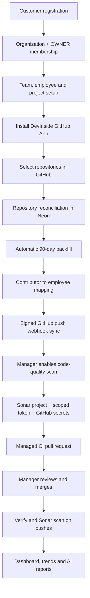
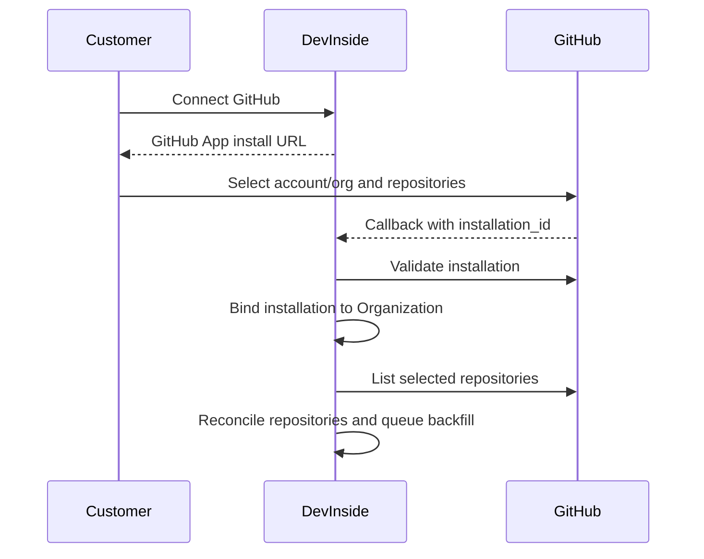
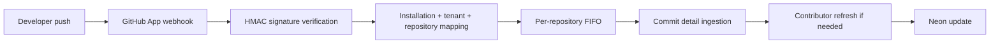
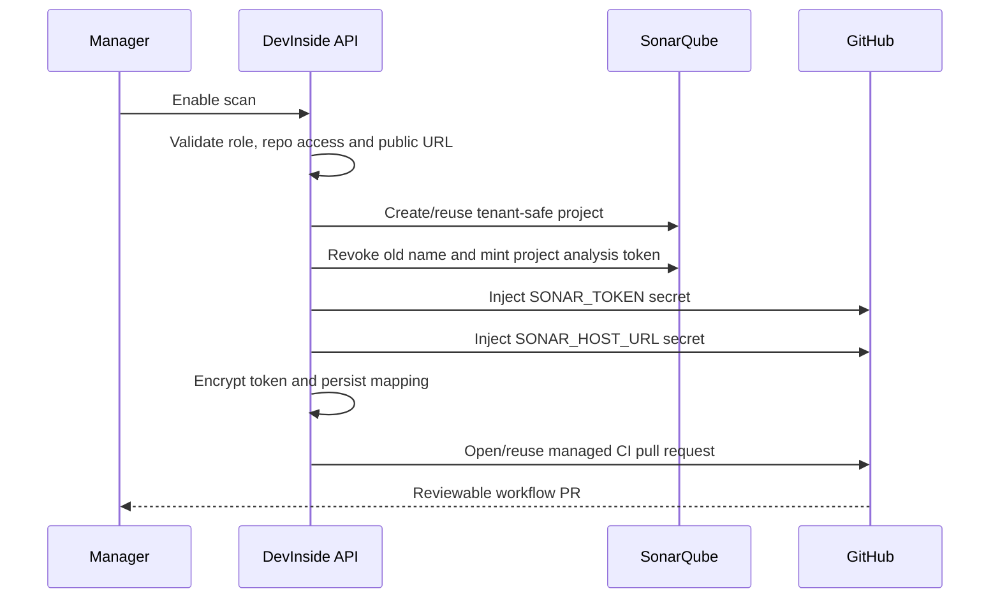
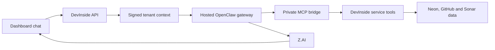
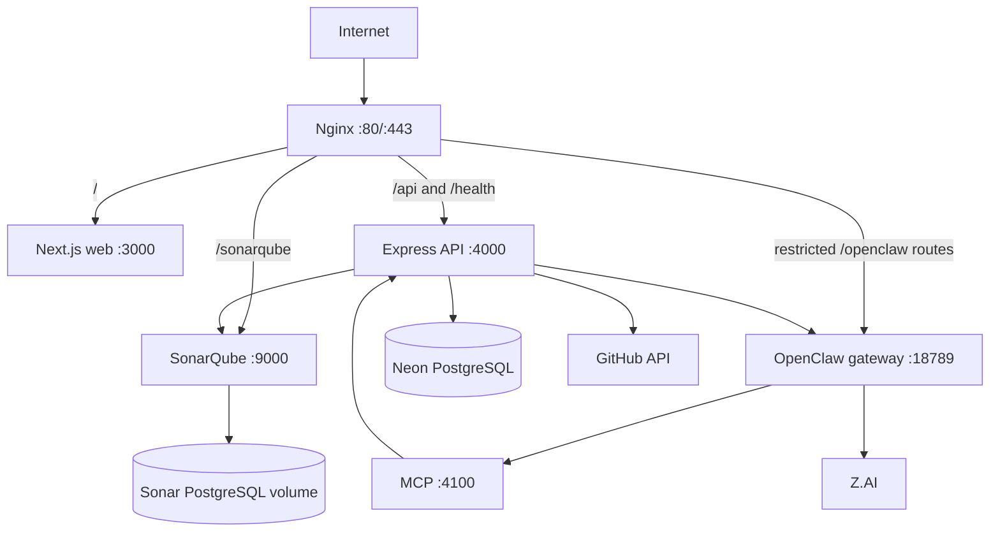

# Customer Onboarding and End-to-End System Flow

> **Purpose:** নতুন customer registration থেকে GitHub repository collection,
> SonarQube/CI provisioning, dashboard, AI report এবং VPS operations পর্যন্ত
> DevInside-এর বর্তমান production flow এক জায়গায় ব্যাখ্যা করা।
>
> **Last updated:** 2026-07-17

## 1. পুরো system এক নজরে



সংক্ষেপে customer account ও Organization তৈরি করে, GitHub App install করে এবং
GitHub-এর ভেতর repository select করে। DevInside repositoryগুলো sync করে, প্রথম
৯০ দিনের activity collect করে এবং এরপর signed push webhook দিয়ে live data রাখে।
Manager `Enable scan` করলে SonarQube project, project-scoped token, GitHub Actions
secrets এবং managed CI workflow automaticভাবে provision হয়।

## 2. Customer registration এবং Organization

Customer registration-এর সময় backend একই transaction-এ:

1. User account তৈরি করে এবং password hash করে রাখে।
2. Unique slug-সহ একটি Organization তৈরি করে।
3. Register করা user-কে Organization-এর `OWNER` membership দেয়।
4. সাত দিনের JWT access token দেয়।
5. `auth.register` action `AuditLog`-এ record করে।

Organization-level roles:

| Role | সাধারণ দায়িত্ব |
|---|---|
| `OWNER` | Organization-এর পূর্ণ management |
| `ADMIN` | Administrative management |
| `MANAGER` | Project, repository, integration এবং report management |
| `EMPLOYEE` | অনুমোদিত Organization data দেখা |

Organization-এর প্রতিটি protected read/write request membership ও role দিয়ে
যাচাই হয়। Manager-level mutation সাধারণত `OWNER`, `ADMIN` ও `MANAGER` করতে পারে।

## 3. Team, employee এবং project setup

Organization তৈরি হওয়ার পরে customer:

- employee/team member record তৈরি বা manage করতে পারে;
- project তৈরি করতে পারে;
- repository-কে project-এর সঙ্গে assign করতে পারে; এবং
- GitHub contributor identity-কে employee-এর সঙ্গে map করতে পারে।

Contributor mapping প্রয়োজন, কারণ GitHub username বা commit email এবং DevInside
employee account আলাদা identity হতে পারে। Mapping হওয়ার পরে per-employee activity,
leaderboard, appraisal, code quality এবং report সঠিক ব্যক্তির সঙ্গে যুক্ত হয়।

## 4. GitHub App connection

DevInside বর্তমানে **GitHub App-only**। Customer Personal Access Token দেয় না।

### 4.1 Installation journey



Flowটি হলো:

1. Manager panel থেকে `Connect GitHub` চাপেন।
2. GitHub-এ personal account অথবা Organization নির্বাচন করেন।
3. `All repositories` অথবা নির্দিষ্ট repositories নির্বাচন করেন।
4. GitHub App approve/install করেন।
5. GitHub `installation_id` দিয়ে callback page-এ ফেরত পাঠায়।
6. DevInside caller-এর authenticated Organization-এর সঙ্গে installation bind করে।
7. Backend GitHub থেকে installation যাচাই করে selected repositories sync করে।

একটি GitHub installation কেবল একটি DevInside Organization-এর সঙ্গে যুক্ত হতে
পারে। অন্য tenant একই installation claim করতে গেলে request reject হয়।

### 4.2 GitHub credential lifecycle

| Credential | কোথায় থাকে | Persisted? |
|---|---|---|
| GitHub App private key | VPS environment | হ্যাঁ, environment secret হিসেবে |
| App JWT | API memory | না; অল্প সময়ের জন্য |
| Installation access token | API memory | না; প্রয়োজনমতো mint হয় |
| Webhook secret | VPS environment | হ্যাঁ, environment secret হিসেবে |

App private key দিয়ে short-lived App JWT তৈরি হয়। সেটি দিয়ে প্রায় এক ঘণ্টার
installation access token mint করা হয়। Repository API call শেষ হলে token database
বা frontend-এ রাখা হয় না।

## 5. Repository reconciliation এবং initial onboarding

GitHub-এর repository selection-ই source of truth। DevInside-এ আলাদা local
select/untrack flow নেই। App link, manual App Sync অথবা GitHub repository-selection
event-এর সময় backend:

1. GitHub থেকে installation-এর accessible repository list নেয়।
2. Organization-scoped `Repository` row create/update করে।
3. `RepositoryAccess` grant create/update করে।
4. আর accessible নয় এমন repository grant reconcile করে।
5. প্রতিটি নতুন accessible repository-এর জন্য initial backfill নিশ্চিত করে।

### 5.1 Automatic 90-day backfill

প্রতিটি selected repository একটি system-owned ৯০ দিনের `CollectionJob` পায়। এই
job:

- সব GitHub branch collect করে, বর্তমান ২৫-branch cap পর্যন্ত;
- commit metadata collect করে;
- changed files, additions এবং deletions collect করে;
- contributor/collaborator identity discover করে;
- existing alias ও employee mapping refresh করে; এবং
- coverage ledger update করে, যাতে একই সময়সীমা অপ্রয়োজনে আবার collect না হয়।

API container-এর in-process collection worker প্রায় প্রতি ৫ সেকেন্ডে job queue
check করে। প্রতি repository-তে একসঙ্গে একটি active deep-collection job থাকে। GitHub
rate limit হলে job resume time-সহ queue-তে ফেরত যায়; transient error-ও retry হয়।

## 6. Live push synchronization

Initial backfill-এর পরে নতুন commit GitHub App-এর একক webhook endpoint দিয়ে আসে:

```text
POST /api/webhooks/github-app
```

Push processing flow:



Backend exact raw request body দিয়ে webhook signature যাচাই করে। Valid delivery-কে
দ্রুত `202 Accepted` দিয়ে background processing শুরু করে। Repository resolve করার
সময় installation ID, Organization, numeric GitHub repository ID, active access
grant এবং App installation mapping একসঙ্গে যাচাই হয়।

একই repository-তে দ্রুত একাধিক push এলে per-repository FIFO অনুযায়ী process হয়।
Commit SHA uniqueness duplicate delivery-কে idempotent রাখে। নতুন username দেখা
গেলে contributor discovery আবার চালানো হয়। Repository-এর `lastWebhookAt` এবং
`webhookStatus` health indicator হিসেবে update হয়।

## 7. Contributor-to-employee mapping

Repository collection GitHub contributor identity আবিষ্কার করে। Manager সেই
identity-কে Organization employee-এর সঙ্গে map, ignore অথবা alias হিসেবে manage
করতে পারে। Mapping হওয়ার পরে system:

- employee-specific commit activity দেখায়;
- project/team leaderboard তৈরি করে;
- GitHub username ও commit email একই ব্যক্তির অধীনে আনে;
- code-quality attribution employee-এর সঙ্গে যুক্ত করে; এবং
- employee/team report সঠিক scope-এ তৈরি করে।

Discovery automatic, কিন্তু ambiguous identity-এর final mapping-এ manager input
লাগতে পারে।

## 8. SonarQube scanning provisioning

> GitHub-এ repository select করলেই SonarQube project তৈরি হয় না। Manager যখন
> repository-এর জন্য **Enable scan** করেন, তখন provisioning শুরু হয়।

বর্তমান shared-platform plan-এ customer কোনো Sonar token manually দেয় না। VPS-এর
backend-only global/operator `SONAR_TOKEN` project provision করার ক্ষমতা রাখে।

### 8.1 Enable scan flow



Backend automaticভাবে:

1. Organization role ও GitHub repository access যাচাই করে।
2. GitHub-hosted runner-এর জন্য `SONAR_PUBLIC_URL` configured আছে কি না দেখে।
3. Tenant-safe Sonar project key তৈরি করে:

   ```text
   devinside-{organizationId}-{repositoryOwner}-{repositoryName}
   ```

4. SonarQube project create করে অথবা existing project reuse করে।
5. কেবল ওই project-এর জন্য fresh project-scoped analysis token তৈরি করে।
6. GitHub App দিয়ে repository Actions secrets inject করে:

   ```text
   SONAR_TOKEN
   SONAR_HOST_URL
   ```

7. Analysis token encrypted অবস্থায় Neon-এ রাখে।
8. Project key এবং provisioning timestamp repository-এর সঙ্গে save করে।
9. Managed CI workflow-এর pull request create অথবা refresh করে।
10. পুরো mutation `AuditLog`-এ record করে।

Global/operator Sonar token GitHub, workflow অথবা customer browser-এ যায় না। GitHub
Actions শুধুমাত্র repository-এর project-scoped token পায়।

### 8.2 Shared fallback এবং organization-specific connection

বর্তমান platform default হলো VPS environment-এর shared Sonar connection। Codebase
প্রয়োজনে Organization-specific SonarQube/SonarCloud connection save করার সুবিধাও
রাখে; সে ক্ষেত্রে token encrypted থাকে এবং ওই Organization-এর provider config
global fallback-এর জায়গায় ব্যবহার হয়। Shared connection ব্যবহার করলে project list
Organization mapping দিয়ে filter করা হয়, যাতে customer অন্য tenant-এর project
enumerate করতে না পারে।

## 9. Managed GitHub Actions CI

Provisioning-এর পরে DevInside repository inspect করে stack ও available root scripts
detect করে এবং deterministic workflow তৈরি করে:

```text
.github/workflows/devinside-ci.yml
```

Workflow সরাসরি default branch-এ silently লেখা হয় না। DevInside একটি reviewable
pull request তৈরি করে; manager review করে merge করেন। Existing managed file-এর
content current template-এর থেকে আলাদা হলে একই flow update PR তৈরি করতে পারে।

### 9.1 `verify` job

Pull request, default-branch push এবং manual dispatch-এ detected scripts অনুযায়ী:

1. Repository checkout করে।
2. Node/npm setup করে।
3. `npm ci` চালায়।
4. প্রয়োজন হলে Prisma client generate করে।
5. Lint চালায়।
6. Typecheck চালায়।
7. Tests চালায়।
8. Production build চালায়।

`verify` correctness job কোনো Sonar secret ব্যবহার করে না।

### 9.2 `code_quality` job

SonarQube Community Edition-এর main-branch limitation অনুযায়ী এই আলাদা job শুধু
push event-এ চলে। এটি:

1. Full Git history checkout করে (`fetch-depth: 0`)।
2. Dependencies install করে।
3. Detected Prisma generation চালায়।
4. Available হলে coverage test চালায়।
5. Immutable commit-এ pinned SonarSource scan action চালায়।
6. Provisioned Sonar project key ব্যবহার করে।
7. সর্বোচ্চ ৩০০ সেকেন্ড Quality Gate-এর জন্য অপেক্ষা করে।

Scanner/auth/transport error অথবা red Quality Gate হলে `code_quality` job fail হয়।
Independent `verify` job-এর result আলাদা থাকে। Community Edition-এর কারণে বর্তমানে
pull request/feature branch Sonar analysis default project view overwrite করে না।

## 10. SonarQube-এর internal এবং public URL

একই SonarQube server-এ API এবং GitHub Actions দুইটি আলাদা network path ব্যবহার করে:

| Consumer | URL | কারণ |
|---|---|---|
| DevInside API container | `http://sonarqube:9000/sonarqube` | Docker internal network |
| GitHub Actions runner | `https://devinside.softathena.com/sonarqube` | Internet-accessible HTTPS endpoint |

Internal URL provisioning ও result reading-এর জন্য। Public HTTPS URL repository
secret হিসেবে inject হয়, যাতে GitHub-hosted runner securely analysis upload করতে
পারে।

## 11. Code-quality dashboard এবং trends

Successful scan-এর পরে repository-এর mapped Sonar project key দিয়ে DevInside:

- Quality Gate status;
- bugs;
- vulnerabilities;
- code smells;
- test coverage;
- reliability/security/maintainability ratings;
- developer attribution; এবং
- historical trends

লোড করে। Organization membership check হওয়ার পরেই result পাওয়া যায়। Code-quality
overview visit-এর সময় best-effort snapshot হয়; API scheduler hourly sweep করে এবং
daily upsert-এর মাধ্যমে trend history তৈরি করে। Sonar unavailable হলে app crash না
করে graceful unavailable state দেখায়।

## 12. AI report generation

Customer repository, project, employee/team এবং period নির্বাচন করে report চাইলে
backend-এর report orchestration flow:

1. Requester-এর Organization membership যাচাই করে।
2. Project, repository, employee এবং date range resolve করে।
3. Requested range-এর activity missing হলে coverage ledger অনুযায়ী শুধু missing
   অংশ collect করে।
4. Commit/file-change activity aggregate করে।
5. Noise-aware employee leaderboard ও engineering signals তৈরি করে।
6. সমান দৈর্ঘ্যের previous period-এর সঙ্গে comparison তৈরি করে।
7. Code-health snapshot ও risk/insight signals যুক্ত করে।
8. Data fingerprint দেখে identical cached report reuse করা যায় কি না যাচাই করে।
9. Configured Z.AI/LLM provider দিয়ে Markdown narrative তৈরি করে।
10. LLM unavailable হলে deterministic fallback report তৈরি করে।
11. Final Markdown report Neon-এ persist করে।

Reports repository, project, employee অথবা team scope-এ হতে পারে। Generated report
history, detail, sharing এবং configured channel delivery flow-এ ব্যবহার হয়।

## 13. OpenClaw chat এবং private MCP

Website chat-এর production flow:



API customer-এর trusted tenant context sign করে OpenClaw-এ পাঠায়। OpenClaw private
MCP bridge দিয়ে DevInside service tools call করে। MCP raw GitHub App secret,
installation token অথবা customer JWT পায় না। Assistant response browser-এ stream
হয়।

OpenClaw gateway এবং MCP port সরাসরি VPS public interface-এ expose করা নেই। Nginx
শুধু authenticated chat completions endpoint ও health endpoint প্রকাশ করে; Control
UI, WebSocket এবং configuration routes public নয়।

## 14. Scheduled automation

API process start হলে দুটি in-process background service চালু হয়:

### Collection worker

- প্রায় প্রতি ৫ সেকেন্ডে queued collection job claim করে;
- প্রতি API instance-এ একবারে একটি job process করে;
- heartbeat দিয়ে interrupted job reclaim করতে পারে;
- rate-limit এবং transient failure retry করে; এবং
- onboarding/deep-history collection progress database-এ রাখে।

### Report scheduler

- প্রতি ৬০ সেকেন্ডে due report schedule check করে;
- daily/weekly/monthly report তৈরি করতে পারে;
- configured channel-এ report deliver করতে পারে;
- প্রায় প্রতি ১৫ মিনিটে due leaderboard snapshot sweep করে; এবং
- hourly code-quality snapshot sweep করে।

বর্তমান scheduler ও FIFO queue in-process হওয়ায় production Compose file API-কে
একটি instance হিসেবে চালায়। Shared distributed queue/lock ছাড়া API multiple replica
করার পরিকল্পনা নেই।

## 15. Production Docker architecture



Production services:

| Service | দায়িত্ব |
|---|---|
| `nginx` | TLS termination এবং reverse proxy |
| `web` | Next.js dashboard |
| `api` | Express API, Prisma, scheduler ও collection worker |
| `sonarqube` | Code analysis এবং Quality Gate |
| `sonar_db` | SonarQube-এর PostgreSQL database |
| `mcp` | OpenClaw-এর private DevInside tool bridge |
| `openclaw-gateway` | Hosted AI agent/runtime |

Main DevInside application database VPS container-এ নেই; এটি external Neon
PostgreSQL। SonarQube database ও Sonar data/extensions/logs Docker volume-এ থাকে।
OpenClaw persistent state `deploy/openclaw` mount-এ থাকে।

সব long-running service `restart: unless-stopped` ব্যবহার করে। তাই Docker daemon
VPS boot-এর সময় চালু হলে containers আবার start হয়। PM2 প্রয়োজন হয় না।

## 16. Deployment management

VPS-এ repository update করার সাধারণ flow:

```bash
cd /opt/projects/dev-insight-saas
git status --short
git pull --ff-only origin main
npm run prod:up
npm run prod:ps
```

`npm` এখানে Node application host-এ চালায় না; `package.json`-এর ছোট Docker Compose
alias চালায়। `npm install` বা host `node_modules` প্রয়োজন নেই।

`npm run prod:up` মূলত:

```bash
docker compose \
  --env-file deploy/.env.prod \
  -f docker-compose.prod.yml \
  --profile sonar \
  --profile openclaw \
  up -d --build
```

চালিয়ে changed image build এবং প্রয়োজনীয় container create/recreate করে। API image
start হওয়ার সময় Prisma `migrate deploy` চালায়। Named Docker volume delete হয় না।
`npm run prod:ps` কেবল service status দেখায়; কোনো service modify করে না।

## 17. Security এবং tenant isolation

System-এর প্রধান security boundaries:

- প্রত্যেক protected operation Organization membership দিয়ে scope করা।
- Manager mutation role-gated এবং audit-logged।
- একটি GitHub installation কেবল একটি DevInside Organization claim করতে পারে।
- GitHub App installation token short-lived এবং memory-only।
- GitHub webhook exact raw body দিয়ে HMAC-verified।
- Push event installation, Organization, numeric repository ID এবং access grant
  দিয়ে resolve হয়।
- Sonar global/operator token কেবল backend environment-এ থাকে।
- GitHub Actions repository-specific project analysis token ব্যবহার করে।
- Stored sensitive token AES-256-GCM cipher দিয়ে encrypted থাকে।
- Shared Sonar connection-এর project listing tenant-owned mapping দিয়ে filter হয়।
- OpenClaw opaque signed tenant context ব্যবহার করে; raw trusted IDs বা platform
  secrets agent-এর হাতে যায় না।
- Secret value API response, frontend অথবা log-এ প্রকাশ করা হয় না।

## 18. Customer বনাম platform automation

### Customer/manager যা করবেন

- Account register এবং Organization তৈরি করবেন।
- Team, employee ও project setup করবেন।
- GitHub App install করে GitHub-এর মধ্যে repositories select করবেন।
- Ambiguous contributor identity employee-এর সঙ্গে map করবেন।
- Repository-এর জন্য `Enable scan` করবেন।
- Generated managed CI pull request review ও merge করবেন।
- প্রয়োজনমতো report/schedule/channel configure করবেন।

### DevInside automaticভাবে যা করবে

- GitHub installation validate ও tenant-এর সঙ্গে bind করবে।
- Repository selection reconcile করবে।
- প্রতিটি repository-এর initial ৯০ দিনের backfill queue করবে।
- Signed push webhook থেকে live commit data ingest করবে।
- Contributor identity discover/refresh করবে।
- Sonar project create/reuse করবে।
- Project-scoped analysis token generate করবে।
- GitHub Actions secrets encrypted transport-এ inject করবে।
- Managed CI workflow PR create/refresh করবে।
- Default-branch push-এ verification এবং Sonar scanning চালাবে।
- Quality Gate ও code-quality measures dashboard-এ আনবে।
- Trend snapshots এবং scheduled reports process করবে।
- OpenClaw/MCP-এর মাধ্যমে tenant-scoped chat tools চালাবে।

## 19. Disconnect এবং data lifecycle

- GitHub-এ repository deselect হলে App repository event repository access reconcile
  করে। Current App-only cleanup policy অনুযায়ী আর granted নয় এমন repository-এর
  DevInside repository-scoped data delete হয়।
- GitHub App uninstall অথবা DevInside panel থেকে disconnect করলে installation এবং
  তার dependent repository-scoped local data transactionalভাবে cleanup হয়।
- Code-quality scan deprovision করলে repository-এর provisioning marker ও encrypted
  project token clear হয়; Sonar project এবং historical analysis বর্তমানে retained
  থাকে। Managed workflow-এর Sonar job পরবর্তী CI workflow update-এ বাদ পড়ে।
- Docker deployment/rebuild named volume delete করে না। Sonar history রাখতে
  `docker system prune --volumes` বা volume-removal command ব্যবহার করা যাবে না।

## 20. বর্তমান গুরুত্বপূর্ণ operational assumptions

1. API একটি container instance হিসেবে চলবে, কারণ worker/scheduler/FIFO বর্তমানে
   in-process।
2. GitHub App-এ Metadata, Contents, Workflows, Pull Requests, Actions এবং Secrets-এর
   প্রয়োজনীয় repository permissions থাকতে হবে। Permission পরিবর্তন হলে customer-কে
   installation re-accept করতে হতে পারে।
3. GitHub App-এ Installation, Installation repositories এবং Push events enabled
   থাকতে হবে।
4. `SONAR_BASE_URL` Docker-internal URL এবং `SONAR_PUBLIC_URL` public HTTPS URL হতে
   হবে।
5. Main application data Neon-এ, Sonar data VPS Docker volumes-এ এবং OpenClaw state
   bind-mounted directory-তে থাকে—backup plan-এ তিনটি storage location-ই ধরতে হবে।
6. Managed workflow file হাতে edit না করে workflow generator update ও template
   version bump করতে হবে।

