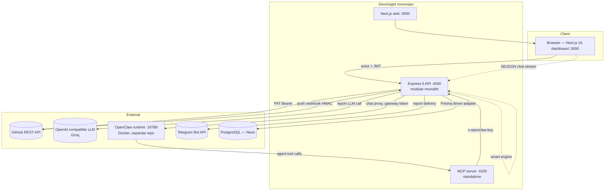
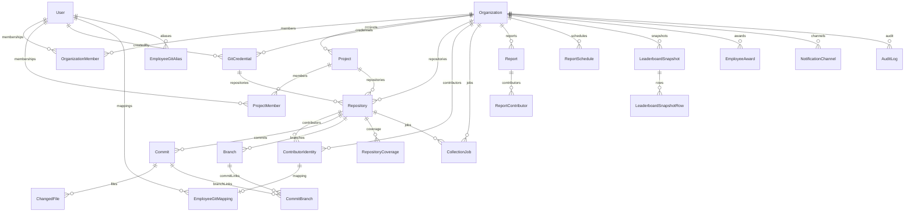
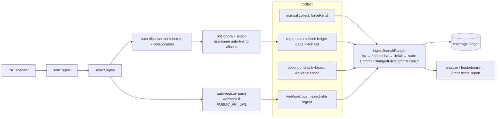
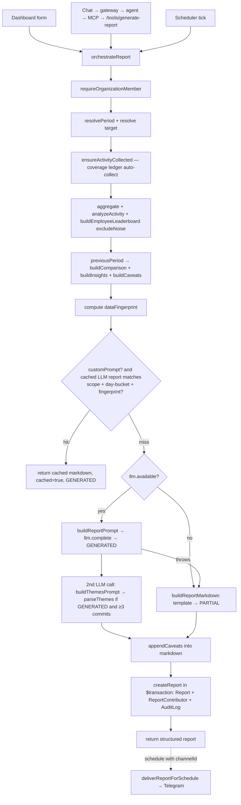
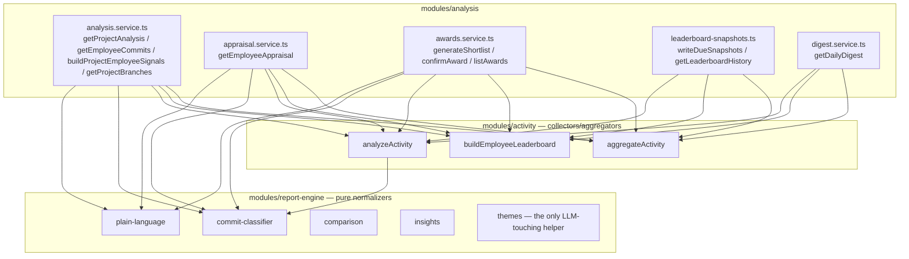

# DevInsight AI — Complete System Architecture Audit

> **Document type:** Senior-architect technical audit — a self-contained snapshot of the *current* implementation.
> **Method:** Every statement is grounded in the actual source (files/functions/migrations named inline). Where a capability is absent it is marked **Not found**, never guessed.
> **Repo state at audit time:** branch `feature/analysis-engine-sonarqube-integration`; backend `apps/api`, frontend `apps/web`, Node ≥ 20.
> **Audit date:** 2026-07-14.
> **Purpose:** another senior engineer/architect should be able to continue development from this document without opening the source.
>
> **Addendum (2026-07-14, post-audit):** The audit's #1 priority — automated tests — has since been **started**. A **Vitest unit suite** now covers `apps/api`'s pure/deterministic cores (87 tests: `token-cipher`, `coverage` interval math, `commit-classifier`, `plain-language`, `comparison`, `insights`, `themes`, `computeNextRun` incl. DST/month-clamp, `resolvePeriod` incl. custom-range/inclusive-day). Config: `apps/api/vitest.config.ts`; tests in `apps/api/tests/unit/**` (outside `src`, so typecheck/lint/build are unaffected). Run with `npm test`. **Still open:** integration tests (report flow with mocked `GitProvider`/`LLMProvider`), `apps/web` tests, and CI. Sections 13/14/15/17/18 below describe the pre-addendum state; read them with this progress in mind.

---

## Table of contents

1. [Project overview](#section-1--project-overview)
2. [Current modules](#section-2--current-modules)
3. [Source-code structure](#section-3--source-code-structure)
4. [Database](#section-4--database)
5. [API](#section-5--api)
6. [GitHub integration](#section-6--github-integration)
7. [AI](#section-7--ai)
8. [Developer performance](#section-8--developer-performance)
9. [Analysis engine](#section-9--analysis-engine)
10. [Score engine](#section-10--score-engine)
11. [Reporting](#section-11--reporting)
12. [Integrations](#section-12--integrations)
13. [What already exists](#section-13--what-already-exists)
14. [What is missing](#section-14--what-is-missing)
15. [Recommended roadmap](#section-15--recommended-roadmap)
16. [Next feature](#section-16--next-feature)
17. [Code quality](#section-17--code-quality)
18. [Final summary](#section-18--final-summary)

---

## SECTION 1 — Project Overview

### Purpose & business domain

**DevInsight AI** is an AI-powered **developer-intelligence / team work-report SaaS**. The business domain is **engineering-management analytics**: a manager connects a Git provider, DevInsight collects commit activity, maps Git contributors to employees, and produces **plain-language, evidence-backed work reports** answering *"what did this repo / person / team / project actually ship this period?"*.

The product's stated *why* (from `docs/` product intent and the memory of record) is **fair, evidence-based employee analysis at appraisal/increment time** — to counter team-lead favouritism and office politics with hard, hard-to-game signals rather than opinion. This thesis visibly shapes the code: the appraisal feature deliberately refuses to emit a single "performance score" and instead surfaces balanced signals + clickable commit evidence + an honest "what data can't see" disclaimer (see [§8](#section-8--developer-performance)).

### High-level architecture

A **pragmatic modular monolith** (Express API) + **Next.js dashboard** + two **standalone AI-bridge processes** (OpenClaw runtime in Docker, and an MCP server). The report pipeline is the heart of the product; every channel (dashboard form, AI chat, scheduled runs, Telegram) funnels through a single backend orchestrator so intelligence lives in one place.

| Layer | Technology | Notes |
|---|---|---|
| **Backend framework** | **Express 5.2.1** on Node ≥ 20, **ESM** (`"type":"module"`, NodeNext), **TypeScript 6** | `apps/api` (`@devinsight/api`) |
| **Frontend framework** | **Next.js 16.2.10** (App Router) + **React 19.2.4**, **Tailwind 4** (CSS-first) | `apps/web` (`@devinsight/web`) |
| **Database** | **PostgreSQL** (Neon), **Prisma 7.8.0** with **driver-adapter** (`@prisma/adapter-pg` + `pg`) | connection injected at runtime via `PrismaPg` in `config/database.ts`; schema datasource has **no `url`** by design |
| **Validation** | **Zod 4** (backend), inline `.parse()` in controllers | — |
| **Auth** | JWT (7-day, `jsonwebtoken`) + `bcryptjs` password hashing; service-key for MCP; HMAC for webhooks | — |
| **Queue** | **Not found** — no Redis/BullMQ/SQS. Background work is **in-process** `setInterval` loops + a **DB-backed job table** (`CollectionJob`) with atomic row-claiming | multi-instance safety is achieved via conditional `updateMany` claims, not a broker |
| **Cache** | **No external cache** (no Redis/Memcached). Two application-level caches exist: the **report cache** (fingerprint match in Postgres) and the **coverage ledger** (avoids re-fetching Git ranges) | see [§7](#section-7--ai) & [§6](#section-6--github-integration) |
| **AI integration** | **LLM** via an OpenAI-compatible provider (`LLMProvider` → `OpenAIProvider`, currently pointed at **Groq**); **OpenClaw** external agent runtime (Docker) reached over an OpenAI-compatible gateway; **MCP server** exposing DevInsight tools | see [§7](#section-7--ai) |
| **External integrations** | **GitHub** (REST, via PAT) — the only Git provider implemented; **Telegram** (Bot API) for report delivery; **OpenAI-compatible LLM** endpoint | GitLab/Bitbucket/Discord/Slack/SonarQube/Jira = **Not found** (see [§12](#section-12--integrations)) |
| **CI/CD** | **Not found** — no `.github/workflows`, no GitLab CI, no Jenkins, **no YAML pipelines anywhere** | local `typecheck`/`lint`/`build` only |
| **Containerization / deploy** | **Not found** in this repo — no Dockerfile, no `docker-compose.yml`, no Vercel/Fly/Railway/Render config | OpenClaw runs in Docker but from its *own* external repo |
| **Tests** | **Unit suite added 2026-07-14** — Vitest in `apps/api` (87 tests across 9 files) covering the pure/deterministic cores (`token-cipher`, `coverage`, `commit-classifier`, `plain-language`, `comparison`, `insights`, `themes`, `computeNextRun`, `resolvePeriod`). **Still missing:** integration tests (report flow with mocked providers), any `apps/web` tests, and CI. See the addendum below. | previously "Not found"; the rest of this audit's snapshot still reflects 2026-07-14 pre-test state where noted |

### System context diagram



### Folder structure (top level)

```
DevInsight/
├── apps/
│   ├── api/          # Express 5 + Prisma 7 backend (ESM, TS 6)
│   └── web/          # Next.js 16 + React 19 dashboard (Tailwind 4)
├── packages/
│   └── shared/       # STUB — exports only APP_NAME; nothing imports it (dead)
├── integrations/
│   ├── devinsight-mcp-server/       # standalone MCP server (:4100) — Express 4, MCP SDK
│   └── devinsight-openclaw-plugin/  # SUPERSEDED by the MCP server; kept for reference
├── docs/             # PROJECT_STATE.md (state of record), OPENCLAW_SETUP.md, blueprints, this audit
├── start-dev.sh      # launches api + web + mcp together (OpenClaw runs separately)
├── CLAUDE.md         # agent working instructions
├── package.json      # npm workspaces root (apps/*, packages/*), Node >=20
└── README.md / DEVINSIGHT_OVERVIEW.md
```

---

## SECTION 2 — Current Modules

The backend is **modular-by-feature** under `apps/api/src/modules/<feature>/`. There are **19 module folders**. The table lists each with its purpose, main service(s), controller/router, DB tables it owns/reads, API base, and completion status.

| Module | Purpose | Main service(s) | Controller / router | DB tables | API base | Status |
|---|---|---|---|---|---|---|
| **auth** | Register/login, JWT issue, `requireAuth` middleware | `auth.service.ts` | `auth.controller.ts` (+ `auth.middleware.ts`) | `User`, `OrganizationMember` | `/api/auth` | ✅ Complete |
| **organizations** | List orgs a user belongs to | `organizations.service.ts` | `organizations.controller.ts` | `Organization`, `OrganizationMember` | `/api/organizations` | ✅ Complete (minimal — read-only) |
| **projects** | Project CRUD + members | `projects.service.ts` | `projects.controller.ts` | `Project`, `ProjectMember` | `/api/projects` | ✅ Complete |
| **employees** | Employee (=User) CRUD, git aliases, bulk CSV import | `employees.service.ts` | `employees.controller.ts` | `User`, `OrganizationMember`, `EmployeeGitAlias`, `EmployeeGitMapping` | `/api/employees` | ✅ Complete |
| **credentials** | Git PAT lifecycle (validate→encrypt→store), username resolution, repo-affiliation filter | `credentials.service.ts` | `credentials.controller.ts` | `GitCredential` | `/api/git-credentials` | ✅ Complete |
| **repositories** | Sync/select/resync repos, project assignment, live-sync (webhook) lifecycle | `repositories.service.ts` | `repositories.controller.ts` | `Repository` (+ webhook fields) | `/api/repositories` | ✅ Complete |
| **activity** | The largest service: commit+file collection, coverage ledger, aggregation, leaderboard, analysis, deep-collection jobs, worker | `activity.service.ts`, `coverage.ts`, `deep-collection.ts`, `collection-worker.ts` | `activity.controller.ts` | `Commit`, `ChangedFile`, `Branch`, `CommitBranch`, `RepositoryCoverage`, `CollectionJob` | `/api/repositories` (2nd mount) | ✅ Complete |
| **contributors** | Discover contributors/collaborators, auto-link via aliases, suggestions, bot-ignore | `contributors.service.ts`, `auto-link.ts` | `contributors.controller.ts` | `ContributorIdentity`, `EmployeeGitMapping`, `EmployeeGitAlias` | `/api/contributors` | ✅ Complete |
| **git-providers** | `GitProvider` interface + provider registry (**abstraction, no endpoints**) | `git-provider.ts`, `provider-registry.ts` | — | — | — | ✅ Complete (port) |
| **github** | GitHub REST implementation of `GitProvider` (**no endpoints**) | `github.provider.ts` | — | — | — | ✅ Complete |
| **llm** | `LLMProvider` interface + `OpenAIProvider` + registry (**no endpoints**) | `openai.provider.ts`, `llm-registry.ts` | — | — | — | ✅ Complete (one provider) |
| **report-engine** | Pure deterministic helpers: commit classifier, comparison, insights, plain-language, themes (**no endpoints**) | `commit-classifier.ts`, `comparison.ts`, `insights.ts`, `plain-language.ts`, `themes.ts` | — | — | — | ✅ Complete |
| **openclaw** | Report orchestration hub (`orchestrateReport`), prompt/template builders, chat gateway + service-key tools | `openclaw.service.ts`, `openclaw.tools.ts`, `openclaw.gateway.ts` | `openclaw.controller.ts`, `openclaw.service-tools.controller.ts` (+ `openclaw.middleware.ts`) | `Report`, `ReportContributor`, `AuditLog` | `/api/openclaw` (two routers) | ✅ Complete |
| **reports** | Report persistence, history, delete, share tokens, public read | `reports.service.ts` | `reports.controller.ts`, `reports.public.controller.ts` | `Report`, `ReportContributor` | `/api/reports`, `/api/public/reports` | ✅ Complete |
| **statistics** | Dashboard aggregates (DB-only, never Git) | `statistics.service.ts` | `statistics.controller.ts` | reads `Commit` | `/api/statistics` | ✅ Complete |
| **analysis** | Per-employee project analysis, appraisal, awards (employee-of-the-month), leaderboard snapshots, daily digest | `analysis.service.ts`, `appraisal.service.ts`, `awards.service.ts`, `leaderboard-snapshots.ts`, `digest.service.ts` | `analysis.controller.ts` | `LeaderboardSnapshot(Row)`, `EmployeeAward`; reads `Commit`/`ChangedFile` | `/api/analysis` | ✅ Complete |
| **schedules** | Recurring reports + in-process scheduler (DST-correct), atomic due-claim | `schedules.service.ts`, `scheduler.ts` | `schedules.controller.ts` | `ReportSchedule` | `/api/schedules` | ✅ Complete (single-instance) |
| **channels** | Notification-channel CRUD + report delivery (Telegram) | `channels.service.ts`, `telegram/telegram.provider.ts`, `telegram-format.ts` | `channels.controller.ts` | `NotificationChannel` | `/api/channels` | ✅ Telegram complete; Discord/Slack **Not found** |
| **webhooks** | GitHub push webhook receiver (HMAC-verified), background ingest | `webhooks.service.ts` | `webhooks.controller.ts` | reads/writes `Repository`, `Commit` | `/api/webhooks` | ✅ Complete (push only) |

**Modules the task template asked about that DO NOT exist as such:**
- **Notifications** — exists only as the `channels` module (Telegram delivery). No in-app notification centre.
- **GitLab / Bitbucket** — the `GitProvider` enum reserves them, but **no implementation exists** (`provider-registry.ts` throws `PROVIDER_UNSUPPORTED`). **Not found.**
- **Developer Performance / Appraisal / AI / Dashboard** as separate modules — these are realised inside `analysis`, `openclaw`, `statistics`, and the frontend, not as discrete backend modules.

---

## SECTION 3 — Source-Code Structure

### Backend `apps/api/src`

```
src/
├── main.ts                     # entry: createApp() → listen → startScheduler() → startCollectionWorker()
├── app.ts                      # Express app: middleware chain + all router mounts + errorHandler (last)
├── config/
│   ├── env.ts                  # Zod-validated env (import `env` here — never read process.env directly)
│   └── database.ts             # PrismaClient built on PrismaPg driver-adapter (runtime connection)
├── common/
│   ├── middleware/error-handler.ts   # the SINGLE place errors → HTTP responses
│   ├── crypto/token-cipher.ts        # AES-256-GCM encrypt/decrypt/last4 for PATs & webhook & bot secrets
│   ├── access/organization-access.ts # requireOrganizationMember / requireOrganizationRole (RBAC in services)
│   ├── http/async-handler.ts         # asyncHandler wrapper
│   └── errors/app-error.ts           # AppError(status, message, code)
└── modules/<feature>/          # *.controller.ts (thin router), *.service.ts (logic+Prisma), *.schemas.ts (Zod)
```

**Responsibilities by layer:**
- **Controllers** — thin Express routers. They wrap async handlers in `asyncHandler(...)`, `.parse()` the request with a Zod schema *inline*, call a service, and shape the JSON response. No business logic.
- **Services** — all business logic + Prisma access. Throw `AppError(status, message, code)` for expected failures. Writes generally run inside `prisma.$transaction` and append an `AuditLog` row. There is **no repository/DAO abstraction over Prisma** — services call Prisma directly (a deliberate simplification for this scale).
- **Schemas** — Zod request validators; several are shared (e.g. `generateReportSchema` is reused by openclaw, reports-service-tools, and schedules).
- **Ports/adapters (the mandatory abstractions):** `GitProvider` (git-providers) with the GitHub adapter (github), `LLMProvider` (llm) with the OpenAI adapter, and `ChannelProvider` (channels) with the Telegram adapter. These are the clean hexagonal boundaries — no controller/service calls GitHub/an LLM/Telegram directly outside them.
- **Pure functions (`report-engine/`)** — IO-free, deterministic, unit-testable helpers (classifier, comparison, insights, plain-language, themes). Kept separate so the analysis/statistics paths never need an LLM.

**Shared libraries / utilities:** `common/crypto/token-cipher.ts` (encryption), `common/access/*` (RBAC helpers), `common/http/async-handler.ts`, `common/errors/app-error.ts`, `common/middleware/error-handler.ts`. `packages/shared` is a **stub** (`export const APP_NAME`) and is **not imported anywhere** — effectively dead.

**Infrastructure code:** `config/database.ts` (Prisma + driver-adapter), `config/env.ts` (boot-time env validation, incl. the base64 32-byte encryption-key check), `scheduler.ts` and `collection-worker.ts` (the two in-process background loops started from `main.ts`).

### Frontend `apps/web/src`

```
src/
├── app/                        # App Router — thin route wrappers
│   ├── layout.tsx              # root: fonts, <html data-theme>, ThemeProvider
│   ├── page.tsx                # landing
│   ├── login/page.tsx
│   ├── share/[token]/page.tsx  # PUBLIC report (async server component; awaits Promise params — Next 16)
│   ├── _of_test/page.tsx       # disposable CSS scratch page
│   └── dashboard/
│       ├── layout.tsx          # client shell: sidebar + topbar + <main> + floating ChatWidget
│       └── <area>/page.tsx     # each renders a "use client" *-manager.tsx
├── components/<area>/          # feature managers (analysis, auth, channels, contributors, credentials,
│                               #   dashboard, employees, layout, openclaw, projects, reports,
│                               #   repositories, schedules, statistics, theme)
└── lib/
    ├── api.ts                  # THE data layer (~1,525 lines, ~74 axios helpers + getApiErrorMessage)
    ├── use-session.ts          # session guard hook (redirect, activeOrganization, canManage)
    ├── auth-storage.ts         # JWT in localStorage (key devinsight.accessToken)
    └── utils.ts                # cn() = clsx + tailwind-merge (shadcn util)
```

**Responsibilities:** routes are thin wrappers; each dashboard page renders one `"use client"` feature manager. All data-fetching goes through `lib/api.ts` (a single shared axios instance with a JWT request interceptor). The one exception is `streamAssistantMessage`, which uses `fetch` + `getReader()` to consume the NDJSON chat stream. State is **component-local `useState`/`useEffect` only** — the `.then()`-in-effect pattern is used everywhere to satisfy Next 16's `react-hooks/set-state-in-effect` rule.

---

## SECTION 4 — Database

**Engine:** PostgreSQL (Neon), Prisma 7 driver-adapter. **25 models, 12 enums, 21 migrations** (2026-07-08 → 2026-07-14). Every model uses `String @id @default(cuid())` **except `CommitBranch`** (composite PK `@@id([commitId, branchId])`).

### Enums (12)

| Enum | Values |
|---|---|
| `OrgRole` | `OWNER`, `MANAGER`, `EMPLOYEE`, `ADMIN` |
| `MemberStatus` | `ACTIVE`, `INVITED`, `DISABLED` |
| `UserStatus` | `ACTIVE`, `DISABLED` |
| `ProjectStatus` | `ACTIVE`, `ARCHIVED` |
| `ProjectRole` | `LEAD`, `DEVELOPER`, `REVIEWER` |
| `GitProvider` | `GITHUB`, `GITLAB`, `BITBUCKET` *(only GITHUB implemented)* |
| `CredentialStatus` | `CONNECTED`, `INVALID`, `DISCONNECTED` |
| `ScheduleCadence` | `DAILY`, `WEEKLY`, `MONTHLY` |
| `CollectionJobStatus` | `QUEUED`, `RUNNING`, `COMPLETED`, `FAILED`, `CANCELLED` |
| `SnapshotGranularity` | `DAILY`, `WEEKLY`, `MONTHLY` |
| `AwardStatus` | `SHORTLISTED`, `CONFIRMED`, `DISMISSED` |
| `ChannelType` | `TELEGRAM` *(single value)* |

### Models by domain (important fields)

**A. Auth/Org** — `User` (`email @unique`, `passwordHash`, `status`), `Organization` (`slug @unique`), `OrganizationMember` (`role: OrgRole`, `status`, `@@unique([organizationId, userId])`). **There is no `Employee` table** — an "employee" is a `User` + an `OrganizationMember` row.

**B. Projects/Employees** — `Project` (`status: ProjectStatus`), `ProjectMember` (`role: ProjectRole`, `@@unique([projectId, userId])`).

**C. Git creds/Repos** — `GitCredential` (`encryptedToken`, `tokenLast4`, `accountLogin`, `scopes`, `repoAffiliations` CSV default `"owner,collaborator,organization_member"`, `status`, `@@unique([organizationId, provider])`); `Repository` (`externalId`, `owner/name/fullName/remoteUrl`, `isPrivate`, `defaultBranch`, **live-sync fields** `webhookExternalId`/`webhookSecret`(encrypted)/`webhookStatus`/`lastWebhookAt`, `@@unique([organizationId, provider, externalId])`).

**D. Contributors/Mapping** — `ContributorIdentity` (**per-repo** git identity, `@@unique([repositoryId, externalId])`, `ignored` flag), `EmployeeGitMapping` (1:1 link `contributorIdentityId @unique` ↔ `userId`), `EmployeeGitAlias` (**org-scoped** declared handle — the source of truth for cross-repo auto-mapping, `@@unique([organizationId, provider, username])`).

**E. Commits/Branches** — `Commit` (`sha`, `message`, `authorName/authorEmail/username`, `committedAt`, `additions/deletions/changedFilesCount`, `@@unique([repositoryId, sha])` dedup), `ChangedFile` (per-file `filePath/status/additions/deletions/changes`), `Branch` (`isDefault/headSha/isProtected`, `@@unique([repositoryId, name])`), `CommitBranch` (M:N join, composite PK — a commit reachable from N branches is counted once).

**F. Coverage/Jobs** — `RepositoryCoverage` (the **coverage ledger**: per `(repositoryId, branch-name-string)` `[rangeStart, rangeEnd]` + `commitCount`, no unique — multiple merged intervals), `CollectionJob` (deep-history background job: `status`, range, `verify`, progress counters, `claimedBy`/`heartbeatAt`/`attempts`/`resumeAt`/`cancelRequestedAt`; **partial unique index** `CollectionJob_one_active_per_repo` added by raw SQL — invisible in schema.prisma).

**G. Reports/Schedules/Sharing** — `Report` (`reportType`/`status`/`generatedBy` are **free-text strings**, `statisticsJson` Json, `dataFingerprint` cache key, `shareToken @unique`, `repositoryId`/`projectId` are **snapshot ids with no FK**), `ReportContributor` (per-report attribution snapshot), `ReportSchedule` (`cadence`, `runHour`/`runMinute`/`timeZone`, `channelId` snapshot, `employeeIds String[]` snapshot array, `nextRunAt`, `last*` bookkeeping).

**H. Analysis/Awards** — `LeaderboardSnapshot` (`scope` = `"org"`|projectId string, `granularity`, `periodKey`, totals, `@@unique([organizationId, scope, granularity, periodKey])`), `LeaderboardSnapshotRow` (ranked contributor), `EmployeeAward` (`score Float`, `commits/lines/activeDays/filesChanged`, `citation`, `detailsJson`, `status: AwardStatus`; **no `@@unique`** — single-winner rule enforced in app logic).

**I. Channels/Observability** — `NotificationChannel` (`type`, `encryptedToken`, `chatId`, `lastDelivery*`), `RequestLog`, `AuditLog` (polymorphic `entityType`+`entityId`, `metadataJson`).

### ER diagram (real FK relations only; snapshot ids omitted — see gaps below)



### Migrations (chronological)

`auth_organization_foundation` → `projects_and_project_members` → `git_credentials` → `repositories` → `contributor_identity_mapping` → `commits_and_changed_files` → `reports` → `repository_coverage` → `report_data_fingerprint` → `branches_and_commit_branch` → `report_schedules` → `schedule_time_of_day` → `employee_git_alias` → `report_share_token` → `collection_jobs` (+raw-SQL partial unique index) → `credential_repo_affiliations` → `repository_webhooks` → `collection_job_verify` → `analysis_snapshots_and_awards` → `notification_channels` → `award_details`.

### Missing entities / modeling gaps (for an incoming architect)

1. **No `Employee` entity** — employees are `User`+`OrganizationMember`; reports/awards reference them by **snapshot `userId` strings** + denormalized `usernames[]`/`name` (resilient to deletion, but no FK integrity).
2. **`EmployeeAward` has no DB uniqueness** for the confirmed winner per scope+period — enforced only in application logic (race risk).
3. **Extensive snapshot ids (no FK):** `Report.repositoryId/projectId`, `ReportContributor.userId/contributorIdentityId`, `ReportSchedule.repositoryId/projectId/employeeIds[]/channelId/lastReportId`, `LeaderboardSnapshot.scope`, `EmployeeAward.userId/confirmedById/createdById`, `NotificationChannel.createdById`, `AuditLog.entityId`. Deliberate (deletion-tolerant) but no referential integrity.
4. **Free-text status/type columns** where enums would fit: `Report.status/reportType/generatedBy`, `Repository.webhookStatus`, `ChangedFile.status`, `ReportSchedule.reportType/lastStatus`.
5. **Coverage ledger keys on a branch-name string**, not a `Branch` FK — decoupled by design.
6. **Webhook is modeled inline on `Repository`** (one hook per repo, no history/multi-hook).
7. **`GitProvider`/`ChannelType` enums are ahead of code** (GitLab/Bitbucket/other channels reserved but unbuilt).
8. **A no-code-visible constraint** (`CollectionJob_one_active_per_repo`, raw SQL) — a schema-only reader would miss it.

---

## SECTION 5 — API

**Base:** all under `/api`. **17 routers** mounted in `app.ts`. Middleware order: `helmet` → `cors` → **webhooks router (before `express.json()`, raw body for HMAC)** → `express.json()` → `pino-http` → `GET /health` → feature routers → `errorHandler` (**last**).

### Auth mechanics
- **`requireAuth`** — `Authorization: Bearer <jwt>`; missing → `401 MISSING_TOKEN`; `jwt.verify(secret)` sets `req.authUser = { id, email, memberships:[{organizationId, role}] }`; failure → `401 INVALID_TOKEN`. **It only authenticates** — org membership & role are re-derived in services.
- **`requireServiceKey`** — timing-safe `x-openclaw-key` compare vs `env.OPENCLAW_SERVICE_KEY`; unset → `503`, mismatch → `401 INVALID_SERVICE_KEY`. Applied **per-route** (so unmatched `/api/openclaw/*` paths fall through to the JWT router).
- **RBAC in services** — `requireOrganizationMember` (any active member; reads) / `requireOrganizationRole(MANAGER_ROLES)` where `MANAGER_ROLES = [OWNER, MANAGER, ADMIN]`; `EMPLOYEE` is read-only.
- **Error envelope** — `ZodError → 400 VALIDATION_ERROR` (with flattened details), `AppError → {code,message}` at its status, else `500 INTERNAL_SERVER_ERROR`.
- **Only streaming endpoint:** `POST /api/openclaw/chat/stream` (NDJSON).

### Mount-order gotchas (must-know)
1. `/api/openclaw` has **two routers** — service-key `openclawServiceRouter` mounted **before** the JWT `openclawRouter`.
2. `/api/public/reports` (unauthenticated share reads) mounted **before** `/api/reports` (JWT).
3. `/api/repositories` is served by **two routers** — `repositoriesRouter` then `activityRouter` (fall-through for method+path combos the first doesn't define; `activityRouter` registers literal `/collection-jobs` before `/:id/...`).
4. `/api/webhooks` mounted **before** `express.json()` (raw body).

### Endpoint catalog (grouped; auth column: **M**=member, **MGR**=manager-role, **SVC**=service-key, **PUB**=public)

**Auth `/api/auth`** — `POST /register` (PUB), `POST /login` (PUB), `GET /me` (JWT).
**Organizations `/api/organizations`** — `GET /` (M).
**Projects `/api/projects`** — `GET /` (M), `POST /` (MGR), `GET /:id` (M), `PATCH /:id` (MGR), `DELETE /:id` (MGR), `POST /:id/members` (MGR), `DELETE /:id/members/:userId` (MGR).
**Employees `/api/employees`** — `GET /` (M), `POST /` (MGR), `POST /bulk` (MGR, ≤500), `GET /:userId` (M), `PATCH /:userId` (MGR), `POST /:userId/git-aliases` (MGR), `DELETE /:userId/git-aliases/:aliasId` (MGR).
**Git Credentials `/api/git-credentials`** — `GET /` (M), `POST /` (MGR), `GET /resolve-user` (MGR), `POST /:id/validate` (MGR), `PATCH /:id/reconnect` (MGR), `PATCH /:id/repo-access` (MGR), `DELETE /:id` (MGR). *Tokens never returned to client.*
**Repositories `/api/repositories`** — `GET /` (M), `POST /sync` (MGR), `POST /select` (MGR), `PATCH /:id` (MGR), `POST /:id/resync` (MGR), `POST /:id/live-sync` (MGR), `DELETE /:id/live-sync` (MGR), `DELETE /:id` (MGR).
**Activity `/api/repositories`** — `GET /collection-jobs` (M), `POST /:id/deep-collect` (MGR, 202), `POST /:id/deep-collect/cancel` (MGR), `POST /:id/activity` (MGR, sync collect), `GET /:id/activity` (M), `GET /:id/branches` (M).
**Contributors `/api/contributors`** — `GET /` (M), `GET /unmapped` (M), `GET /unmapped-summary` (M), `GET /suggestions` (MGR), `POST /discover` (MGR), `POST /:id/map` (MGR), `DELETE /:id/map` (MGR), `POST /:id/ignore` (MGR).
**OpenClaw service-tools `/api/openclaw`** — `POST /tools/generate-report` (SVC), `GET /tools/context` (SVC).
**OpenClaw (JWT) `/api/openclaw`** — `GET /tools` (JWT), `POST /reports/generate` (M), `GET /chat/status` (JWT), `POST /chat/stream` (M, **NDJSON stream**).
**Public reports `/api/public/reports`** — `GET /:token` (PUB — presentational fields only).
**Reports `/api/reports`** — `GET /` (M), `GET /:id` (M), `DELETE /:id` (MGR), `POST /:id/share` (MGR), `DELETE /:id/share` (MGR).
**Statistics `/api/statistics`** — `GET /overview` (M).
**Analysis `/api/analysis`** — `GET /project` (MGR), `GET /project/branches` (MGR), `GET /project/commits` (MGR), `GET /appraisal` (MGR), `GET /leaderboard-history` (M), `GET /digest` (M), `GET /awards` (M), `POST /awards/shortlist` (MGR), `POST /awards/:id/confirm` (MGR).
**Schedules `/api/schedules`** — `GET /` (M), `POST /` (MGR), `PATCH /:id` (MGR), `DELETE /:id` (MGR), `POST /:id/run` (MGR).
**Channels `/api/channels`** — `GET /` (M), `POST /` (MGR), `POST /detect` (MGR), `POST /send-report` (MGR), `POST /:id/test` (MGR), `PATCH /:id` (MGR), `DELETE /:id` (MGR).
**Webhooks `/api/webhooks`** — `POST /github/:repositoryId` (PUB, HMAC `X-Hub-Signature-256`; `ping`→200, `push`→202 then async ingest, other→202 ignored).

**Key shared body — `generateReportSchema`:** `organizationId`, `reportType` (`repository|project|employee|team`), `repositoryId?`, `projectId?`, `employeeIds?`, `period` (`today|yesterday|last_7_days|last_30_days|last_90_days|this_month|last_month|custom`), `customRange?{from,to}`, `customPrompt?` (bypasses cache), `branch?`. `superRefine`: repository⇒repositoryId, project⇒projectId, employee⇒employeeIds; `team` may omit ids (= whole org) — **but the schedule schema requires ids for `team`** (a documented divergence).

---

## SECTION 6 — GitHub Integration

All Git access is funneled through the `GitProvider` interface (`git-providers/git-provider.ts`), resolved by `getGitProvider()`; the only implementation is `GitHubProvider` (`github/github.provider.ts`). **No controller/service calls GitHub directly** — the abstraction rule holds throughout.

### Auth — **PAT, not OAuth**
- **OAuth: Not found.** No `client_id`/`client_secret`/authorize/redirect/token-exchange anywhere. The only OAuth-adjacent code reads the `x-oauth-scopes` response header. Auth is a manager-supplied **Personal Access Token** validated on connect via `GET /user`.
- Header: `Authorization: Bearer <token>` (works for classic & fine-grained PATs) + `Accept: application/vnd.github+json`, `X-GitHub-Api-Version: 2022-11-28`.
- **Storage:** `common/crypto/token-cipher.ts` — **AES-256-GCM**, 12-byte random IV, key from `GIT_TOKEN_ENCRYPTION_KEY` (base64 32-byte, validated at boot). On-disk format `base64(iv):base64(authTag):base64(ciphertext)`. Only `tokenLast4` is ever exposed; decryption happens server-side moments before a provider call; tokens are never logged. One credential per org per provider (upsert). **Same cipher secures webhook secrets and Telegram bot tokens.**
- **Username resolution:** the credential's own login (`GET /user`) and, for mapping, `resolveGitUser` → `GET /users/{username}` (returns `type` User/Org; `null` on 404).
- **Repo affiliations:** `GitCredential.repoAffiliations` mirrors GitHub's `affiliation=` param — a **browse/sync-list filter only** (never untracks; `resyncRepository` ignores it).

### GitHub REST surface actually used (REST only — **GraphQL: Not found**)
`GET /user`, `GET /users/{u}`, `GET /user/repos` (affiliation), `GET /repos/{o}/{r}/contributors`, `.../collaborators`, `.../branches`, `.../commits` (since/until/sha=branch), `.../commits/{sha}` (per-file stats), `POST .../hooks`, `DELETE .../hooks/{id}`.
- **Pagination:** `PER_PAGE=100`, `MAX_PAGES=10` → **1000-item ceiling** per list; `maxCommitsPerList=1000` exposed so the collector can bisect. Warns at cap.
- **Rate limits:** centralized in `request()` — 403/429 + (`x-ratelimit-remaining:0` or `retry-after`) → typed `GitRateLimitError (429 GIT_RATE_LIMITED, resetAt)`, evaluated **before** the 403→INVALID_CREDENTIAL branch. The provider **never sleeps**; callers decide policy.
- **Error mapping:** network → `502 GIT_PROVIDER_UNREACHABLE`; 401/403 → `400 INVALID_CREDENTIAL` (except collaborators, non-fatal); 404 → `404 REPO_NOT_ON_PROVIDER`; empty repo → `[]` (204/409); webhook 403/404 → `400 WEBHOOK_PERMISSION_DENIED` (names the scope).

### Webhooks — implemented, **push only**
- **Registration:** `registerWebhook` needs `PUBLIC_API_URL`; generates a per-repo `randomBytes(32)` secret, stores it **encrypted**, points the hook at `${PUBLIC_API_URL}/api/webhooks/github/{repoId}`. **Auto-enabled on repo select** (best-effort; permission failure just logs). Manual `POST/DELETE /:id/live-sync`.
- **Signature verification:** `verifySignature` — constant-time HMAC-SHA256 over the raw body vs `X-Hub-Signature-256`, per-repo secret decrypted. Unknown repo → 404; bad/missing sig → 401.
- **Handling:** `ping`→200; non-push→202 ignored; `push`→**202 immediately** then background `handlePushDelivery` (never throws): per-repo in-memory debounce, then `ingestPushedCommits` (exact-sha ingest, no coverage recorded — immune to date semantics), else 48h `forceRelist` fallback. Updates `webhookStatus` ACTIVE/ERROR.

### Pull Requests / Reviews / Branches
- **PRs & code reviews: Not found.** No `/pulls`, `/reviews`, `/issues` calls; no PR/review methods on `GitProvider`; no PR/review tables. The unit of activity is the **commit** only. (This is the single biggest data-dimension gap — see [§14](#section-14--what-is-missing)/[§16](#section-16--next-feature).)
- **Branches:** fully modeled — `Branch` + `CommitBranch` (M:N); commits deduped per repo, linked to every containing branch, so multi-branch work isn't double-counted. Reports read across all branches by default (unmerged work included) with optional branch filter. Caps: `MAX_BRANCHES=25` (default first), `MAX_DETAIL_COMMITS=150` (∞ for deep jobs), `MAX_FILES_PER_COMMIT=300`.

### Coverage ledger + collection (the "smart engine")
- `RepositoryCoverage` + pure `coverage.ts` (`mergeIntervals`, `subtractCovered`) track which `[from,to]` windows per branch are already collected. `ingestRepository` has a **fast path: 0 Git calls when every branch already covers the window**; otherwise it fetches only the missing sub-ranges.
- **Committer-date blind spot** (commits authored earlier, pushed later) is mitigated three ways: `forceRelist` (manual collect + webhook fallback), `relistTailFrom` (near-now report windows re-list a trailing 48h), and exact-sha webhook ingest.
- `ensureActivityCollected(scope, from, until)` is the entry point `orchestrateReport` calls; a repo with no credential/an error is **skipped with a warning** (reports never fail on collection problems).

### Deep-history background jobs (Phase E) — production-grade
`CollectionJob` (DB-backed) + `deep-collection.ts` + `collection-worker.ts`: manager triggers `POST /:id/deep-collect` (lookback 30d–10y, `verify` mode). One active job per repo (partial unique index). The worker (`5s` tick) **atomically claims** via conditional `updateMany`, reclaims dead instances via stale heartbeat (>180s), chunks by 30/120-day windows newest-first, **bisects on listing truncation** (floor 1h / depth 12), rate-limit→requeue after reset, transient→backoff, permanent codes→FAILED, resumes from the ledger. **Multi-instance-safe.**

### Contributor discovery + auto-linking
Discovery merges `contributors` + `collaborators`, upserts `ContributorIdentity`, **auto-ignores bots** (`[bot]` suffix + a known-bot set), and **auto-links exact-username matches** to `EmployeeGitAlias` in the same transaction (forward + reverse passes across all org repos). Lower-confidence **suggestions** (email match 0.95 / name-similarity) are surfaced for one-click manager confirmation. Manual map also writes an alias so it propagates to every repo.



---

## SECTION 7 — AI

### The report orchestrator — one chokepoint for every channel
`orchestrateReport(requesterId, input)` in `openclaw/openclaw.service.ts` is the single entry point used by the **dashboard form**, the **AI chat** (via MCP), and **scheduled runs**. End-to-end:



- **Cache fingerprint** (`computeFingerprint`): `c{commits}-a{adds}-d{dels}-f{files}-t{lastCommitMs}-s{lastSha}`, then folded with the **previous-period baseline** (`-p{prevCommits}s{prevSha}`) and **branch** (`b:{branch}|…`). `findCachedReport` matches org+type+targets+fingerprint + **day-bucketed** period, and only reuses `generatedBy:"llm", status:"GENERATED"` rows. **Custom prompts always regenerate.** Fixed past ranges → 0 Git + 0 LLM on repeat; relative windows → one cheap tail-list, cache hit if no new commits.

### LLM layer
- `LLMProvider` interface (`available`, `complete(messages)`), one impl `OpenAIProvider` — OpenAI-compatible chat completions, `Bearer OPENAI_API_KEY`, `model=OPENAI_MODEL`, `temperature 0.4`. Swappable to Groq/Gemini/Ollama/OpenAI by env only (currently **Groq**). Errors → `502 LLM_UNREACHABLE/LLM_ERROR/LLM_EMPTY`. **No second concrete provider** (Anthropic/local) wired.
- **Template fallback** (deterministic Markdown) is built first; the LLM only *replaces* it when available; any error keeps the template → `status: PARTIAL, generatedBy: "template"`. **Reports never fail on LLM problems** (core guardrail preserved).

### Prompt builders (`openclaw.tools.ts`, `report-engine/*`)
- `buildReportPrompt` produces a system turn targeting **managers/non-technical readers** ("plain business language, not developer jargon") + a user turn assembling: totals, work-breakdown, most-changed areas, risk signals, a **plain-language facts block** (activity level, humanized work-mix/areas, most-active person), comparison lines (only when a baseline exists), insights, a noise-free contributor leaderboard, and 60 sample commit messages. It mandates exact sections: `## Summary` → `## Key insights` → **`## What shipped`** (cluster commits into named initiatives — "the most important section") → `## Who did what` → `## Trend vs previous period`.
- `buildReportMarkdown` is the deterministic template producing the same section vocabulary without an LLM.
- **Theme detection:** a *second*, cheap LLM call `buildThemesPrompt`/`parseThemes` clusters commits into 3–6 named initiatives (`title/summary/size`), persisted in `statisticsJson` (so history/shared reports carry it). Template reports get no themes (semantic clustering needs an LLM).
- **Commit summaries** are LLM-generated inside the report narrative (`## What shipped`); there is no separate per-commit summarization endpoint.
- **Recommendation system: Not found** — no "recommended actions" engine beyond rules-based `insights` (volume swing, bus-factor concentration, off-hours/burnout, dependency-churn, work-type skew, new/departed contributors).

### OpenClaw chat path + MCP
- **Chat widget** → `POST /api/openclaw/chat/stream` (NDJSON, 20-turn client-sent memory window, aborts upstream on disconnect, clean 503 if gateway unset) → `openclaw.gateway.ts` forwards to the OpenClaw gateway `/v1/chat/completions` (SSE, `model:"openclaw/default"`, server-side token, org/requester system note) → the OpenClaw agent → the **MCP server** (`integrations/devinsight-mcp-server/server.mjs`, streamable-HTTP :4100) which exposes exactly two tools — `devinsight_context` and `devinsight_generate_report` — calling the service-key endpoints. **Single-org MVP** (org/requester pinned in `run.sh`). The smart-engine logic lives in the API, not the MCP server (per project rule).

---

## SECTION 8 — Developer Performance

**How "performance" is represented today:** DevInsight **deliberately does not compute a per-employee performance score, grade, or AI verdict.** This is an explicit product decision (the appraisal service's own doc-comment: *"Deliberately NOT a single score and NOT an AI verdict… Deterministic (never calls an LLM)"*). It fits the product thesis — counter favouritism with **balanced, hard-to-game signals + evidence**, not a black-box number. Statement: **No per-employee performance score exists.**

Three developer-performance-adjacent surfaces exist, all **deterministic** (no LLM):

### 1. Project analysis (`analysis.service.ts` `getProjectAnalysis`, manager-only)
Per project member, single bounded pass (caps 2000 commits / 10 000 files):
- `commits`, raw `additions/deletions/lines`, **`filteredLines`** (= non-noise lines; ranking is by filteredLines so a lockfile bump can't inflate anyone), `excludedLines`.
- `activeDays` (distinct local commit-days), `categories` (via `classifyCommit`), `riskyCommits` (`hasRiskKeyword`), `largeCommits` (>400 raw lines), `topModules` (top-3 by non-noise changes), sample messages, `lastCommitAt`.
- Non-member activity surfaces separately as `unmapped[]` (the mapping gap = the "invisible" person). Explicitly framed in code and UI as **"activity signals, not performance verdicts."**

### 2. Appraisal (`appraisal.service.ts` `getEmployeeAppraisal`, manager-only) — the product's core deliverable
Scope = org (default) or a project; window = last N months (default 6, ≤24) or custom. Resolves the employee's mapped usernames; **no linked identity → an honest empty appraisal** whose only finding is "link their Git identity." Single bounded pass (caps 3000 commits / 30 000 files), noise-free lines. Outputs:
- **Headline:** `effectiveLines` (noise-free "real work"), `rawLines`, `commits`, `activeDays`, first/last commit.
- **Consistency:** active-weeks/total-weeks (+%), gap-filled monthly activity (catches the steady contributor vs a pre-review burst).
- **Focus:** plain-language work-mix + humanized areas. **Ownership:** module breadth + commits in security-critical paths (`isSensitivePath`). **Kind of work:** features/bugFixes/refactors/largeCommits/riskyCommits (**raw counts, not a score**).
- **Team comparison:** two independent rankings — by noise-free real work AND by number of updates (so nobody leans on one number).
- **Evidence:** top-12 most substantial commits (sensitive-first, then most real lines), each with a **clickable `commitUrl`** — undeniable proof.
- **`dataBlindSpots`:** fixed honesty notes ("counts ≠ difficulty/quality; review, mentoring, planning, incident response aren't in Git; truncation").

### 3. Commit classification (`report-engine/commit-classifier.ts`) — the shared primitive
`classifyCommit` → `Feature | Fix | Refactor | Docs | Test | Chore | Perf | Build | Other`. Order: merge→Chore; conventional-commit prefix (`PREFIX_MAP`); then a most-specific-first keyword/imperative-verb fallback (so "add tests"→Test, "update deps"→Chore, "optimize"→Perf, "rename/extract"→Refactor, "implement/support"→Feature, generic "update/improve"→Refactor), else Other. Companions: `hasRiskKeyword` (revert/hotfix/security/critical/breaking/CVE…), `isSensitivePath` (auth/security/.env/migrations/credential/token), `isNoisePath` (lockfiles/generated dirs/minified), `moduleFromPath`. `LARGE_COMMIT_THRESHOLD = 400`.

---

## SECTION 9 — Analysis Engine

**Does an Analysis Engine exist? YES — as a module, not a single "engine" class.** It lives at `apps/api/src/modules/analysis/` (mounted `/api/analysis`) and is a set of **manager-facing read-services that compose lower-level primitives**. There is no `AnalysisEngine` class, no pluggable collector/normalizer/pipeline abstraction *inside* `analysis/` — it delegates to two lower layers.

### Architecture



- **Collectors/aggregators (`activity.service.ts`):** `aggregateActivity` (SQL sums), `buildEmployeeLeaderboard` (group by username, fold an employee's multiple handles, optional noise subtraction, rank by effective lines), `analyzeActivity` (categories/modules/risks + off-hours count + noise-change share).
- **Normalizers (`report-engine/`):** the pure classifier/plain-language/comparison/insights/themes helpers.
- **Pipelines:** the closest thing to a "pipeline" is the **report pipeline** (`orchestrateReport`, [§7](#section-7--ai)) and the **collection pipeline** ([§6](#section-6--github-integration)) — both live outside `analysis/`.

### "Analysis snapshots" & awards
The migration named `analysis_snapshots_and_awards` creates **`LeaderboardSnapshot` + `LeaderboardSnapshotRow` + `EmployeeAward`** — there is **no table literally named `AnalysisSnapshot`**. Leaderboard snapshots are written by the scheduler (`writeDueSnapshots`, 15-min throttle) for each org × scope (`"org"` + each active project) × completed DAILY/WEEKLY/MONTHLY period (raw lines, top-50 rows), bounded backfill (14 days / 4 weeks / 3 months), idempotent by `@@unique`. They power the daily-digest rank-deltas/streaks and award comparisons.

> **SonarQube / static-analysis / code-quality provider inside the analysis engine: Not found.** All "analysis" is derived purely from Git commit data (messages, line counts, file paths). See [§12](#section-12--integrations).

---

## SECTION 10 — Score Engine

**There is exactly ONE numeric score in the entire codebase** — the **employee-of-the-month award shortlist score** (`analysis/awards.service.ts` `scoreCandidates`). There is **no developer-performance score engine** (see [§8](#section-8--developer-performance)).

### The award score — responsibilities, formula, weights
`generateShortlist` (manager-gated) resolves last completed month + scope, builds the month's leaderboard, computes distinct active-days per employee, then `scoreCandidates`:

```js
const WEIGHTS = { commits: 0.3, lines: 0.3, activeDays: 0.25, filesChanged: 0.15 };

score =
  0.30 * (commits      / maxCommits) +
  0.30 * (lines        / maxLines)   +   // RAW lines (no noise exclusion here)
  0.25 * (activeDays   / maxActiveDays) +
  0.15 * (filesChanged / maxFiles);
```
- Each denominator is `Math.max(1, …)` → no divide-by-zero; an all-zero metric contributes 0. Score rounded to 3 dp; sort by score desc, tie-break lines desc; top-5 shortlist; `rank = i+1`.
- **Only mapped employees are eligible.** Unit-verified: steady broad work (0.88) beats a single-commit line spike (0.36).
- **Citations:** one best-effort LLM call for the whole shortlist (index-marker parsing); any skipped candidate keeps a deterministic template citation → never blank. `detailsJson` (projects/workType/areas) is computed deterministically and persisted.
- `confirmAward` → one `CONFIRMED`, siblings `DISMISSED` (single winner, app-logic-enforced).

### Missing / notable
- **Noise-exclusion inconsistency:** the award score uses **raw lines** (dependency churn *can* lift it), whereas the appraisal's team comparison uses **noise-free** lines. A real inconsistency worth reconciling.
- **Deferred (documented):** risk-penalty + module-breadth in the award score (kept to 4 metrics for MVP transparency).
- **No score is attached to any employee outside the awards feature** — no grades, no rankings persisted per person beyond leaderboard snapshots.

---

## SECTION 11 — Reporting

### Dashboard / analytics UI
- **Overview** (`components/statistics/statistics-dashboard.tsx`) IS the dashboard: period selector, KPI stat-tiles, a gap-filled daily commit AreaChart, top contributors, per-repo/per-project breakdowns, a **daily-digest card** (yesterday-in-review with ▲▼ rank-deltas + 🔥 streaks), a **leaderboard-history panel**, an **org-scoped awards panel**, a **one-click "Today's report"** button, and an unmapped-contributor nudge.
- **Charts are hand-rolled** (`components/statistics/charts.tsx`: `StatTile`, `BarList`, `AreaChart` as inline SVG) — **no charting library** anywhere. Single-hue indigo per dataviz guidance.
- **Analysis page** (manager-only): project/branch/period selectors, per-employee cards, a **compare panel** (2-employee side-by-side), per-employee commit details, an inline **AI-report** button, and the awards shortlist.
- **Appraisal page** (manager-only): per-employee evidence-backed appraisal with a fairness banner, consistency mini-chart, focus/ownership/kind-of-work/team-standing cards, a **clickable evidence list**, blind-spots note, and Print/PDF.

### Reports
- **Statistics service** (`getStatisticsOverview`) reads **only stored commits** — never Git; 7 aggregate queries in parallel, gap-filled local-day series (cap 180), leaderboard, per-repo/project, categories/risks.
- **Report persistence/history/detail** (`reports.service.ts`): `Report` + `ReportContributor`, `statisticsJson` also carries comparison/insights/themes so **history & shared reports render the same structured panels**. Export = frontend copy + download `.md`. **Share link** = manager-mints a `randomBytes(24)` token; unauthenticated `GET /api/public/reports/:token` returns presentational-only fields; public `/share/[token]` page with Print/PDF, no auth/chrome. Delete = manager-gated.
- **Manager vs developer reports:** report *types* are `repository | project | employee | team`; there is no separate "manager report" vs "developer report" split — access is role-gated (analysis/appraisal are manager-only; report generation is org-visible).
- **Reporting intelligence** (all in the backend pipeline, so every channel benefits): plain-language executive `## Summary`, `## What shipped` initiative clustering, period-over-period **trend comparison** + rank movement, rules-based **key insights**, noise-free leaderboard ranking, "Good to know" caveats, and a Simple/Detailed reading-mode toggle (dashboard + share page).

**Completion status:** ✅ Dashboard, reports, analytics, charts, sharing, export, scheduling, and Telegram delivery are all built and verified on real data. Missing: Discord/Slack delivery, a structured (non-markdown) analytics API for external BI, and any PR/review-based reporting.

---

## SECTION 12 — Integrations

| Integration | Current support | Missing / status |
|---|---|---|
| **GitHub** | ✅ Full — PAT auth, repos/contributors/collaborators/branches/commits/commit-detail, push webhooks (HMAC), deep-history jobs | OAuth, GraphQL, PRs/reviews/issues |
| **GitLab** | ❌ Enum reserved (`GitProvider.GITLAB`) | **Not found** — no implementation (`provider-registry` throws) |
| **Bitbucket** | ❌ Enum reserved | **Not found** |
| **OpenAI-compatible LLM** | ✅ `OpenAIProvider`, currently **Groq**; swappable by env | Only one concrete provider; no Anthropic/local adapter |
| **OpenClaw** | ✅ External agent runtime (Docker) via OpenAI-compatible gateway + MCP server (2 tools) | Single-org MVP; multi-org needs per-chat org resolution |
| **Telegram** | ✅ Full — Bot API delivery (encrypted token, detect-chats, test, chunked text + `.md` attachment for long reports), wired into schedules | — |
| **Discord** | ❌ Comment-only ("later drop-in") | **Not found** — no provider, no enum value |
| **Slack** | ❌ Comment-only | **Not found** |
| **SonarQube** | ❌ | **Not found anywhere in code/config/env/deps/migrations/docs** — exists ONLY as the git branch name `feature/analysis-engine-sonarqube-integration` |
| **Jira / Linear / issue trackers** | ❌ | **Not found** |
| **OpenAI (as OpenAI)** | ⚪ Compatible (the provider is OpenAI-shaped) but currently pointed at Groq | — |
| **Anthropic / Claude** | ❌ | **Not found** as a wired provider (would slot into `llm-registry`) |
| **Email / SMTP** | ❌ | **Not found** (no email invites/delivery) |

**Provider-abstraction readiness:** the architecture is well-prepared for new integrations — `GitProvider`, `LLMProvider`, and `ChannelProvider` are clean ports; adding GitLab, Anthropic, or Discord means one adapter + a registry entry (+ an enum value for channels), no controller/service rewrites.

---

## SECTION 13 — What Already Exists

| Feature | Status | Confidence | Implementation files | Notes |
|---|---|---|---|---|
| Auth (JWT register/login/me) + RBAC | ✅ | High | `modules/auth/*`, `common/access/*` | 7-day JWT, bcryptjs, role checks in services |
| Organizations / multi-tenancy | ✅ | High | `modules/organizations/*`, `Organization*` models | org-scoped everything |
| Projects + members | ✅ | High | `modules/projects/*` | LEAD/DEVELOPER/REVIEWER |
| Employees + git aliases + bulk CSV import | ✅ | High | `modules/employees/*`, `EmployeeGitAlias` | employee = User+member |
| Git PAT lifecycle (AES-256-GCM) | ✅ | High | `modules/credentials/*`, `common/crypto/token-cipher.ts` | never returned/logged |
| Repo sync/select/resync + affiliations | ✅ | High | `modules/repositories/*` | affiliation browse filter |
| Commit + file collection (branch-aware) | ✅ | High | `modules/activity/activity.service.ts` | dedup, CommitBranch, caps |
| Coverage ledger (smart auto-collect) | ✅ | High | `activity/coverage.ts`, `ensureActivityCollected` | fast-path, date-blind-spot mitigations |
| Deep-history background jobs + worker | ✅ | High | `activity/deep-collection.ts`, `collection-worker.ts` | multi-instance-safe, bisecting |
| Live sync (GitHub push webhooks, HMAC) | ✅ | High | `modules/webhooks/*`, `repositories.service.ts` | push only, in-memory debounce |
| Contributor discovery + auto-link + suggestions + bot-ignore | ✅ | High | `modules/contributors/*`, `auto-link.ts` | exact-username auto, email/name suggested |
| Report orchestrator (all channels) | ✅ | High | `openclaw/openclaw.service.ts` | resolve→collect→analyze→cache→LLM/template→persist |
| Report cache (fingerprint) | ✅ | High | `openclaw.service.ts`, `reports.service.ts` | day-bucketed, LLM-only |
| LLM report generation + template fallback | ✅ | High | `modules/llm/*`, `openclaw.tools.ts` | Groq; never fails |
| Plain-language + What-shipped + insights + trend + themes | ✅ | High | `report-engine/*` | executive-readable |
| Report persistence/history/delete/export | ✅ | High | `modules/reports/*` | copy + download `.md` |
| Public share links | ✅ | High | `reports.public.controller.ts`, `app/share/[token]` | unauthenticated, presentational only |
| Statistics dashboard (DB-only) | ✅ | High | `modules/statistics/*`, web charts | hand-rolled SVG charts |
| Project analysis (per-employee) | ✅ | High | `analysis/analysis.service.ts` | activity signals |
| Appraisal (evidence-backed, no score) | ✅ | High | `analysis/appraisal.service.ts` | the core deliverable |
| Employee-of-the-month awards (scored) | ✅ | High | `analysis/awards.service.ts` | the only score |
| Leaderboard snapshots + daily digest | ✅ | High | `analysis/leaderboard-snapshots.ts`, `digest.service.ts` | scheduler-written |
| Scheduled reports (DST-correct) | ✅ | High | `modules/schedules/*` | single-instance, atomic claim |
| Telegram report delivery | ✅ | High | `modules/channels/*` | encrypted token, `.md` attach |
| AI chat (streaming, OpenClaw+MCP) | ✅ | High | `openclaw.gateway.ts`, MCP server | single-org MVP |
| Audit logging | ✅ | High | `AuditLog`, in-transaction writes | polymorphic |

---

## SECTION 14 — What Is Missing

| Feature | Priority | Difficulty | Dependencies | Est. effort |
|---|---|---|---|---|
| **Automated tests (Vitest + Supertest)** | 🔴 Critical | Medium | none (mock GitProvider/LLMProvider already envisioned) | 1–2 wks to a meaningful suite |
| **CI/CD pipeline** (GitHub Actions: typecheck/lint/build/test) | 🔴 Critical | Low | tests desirable first | 1–3 days |
| **Deployment / containerization** (Dockerfiles, compose, prod env, migration deploy) | 🔴 High | Medium | env/secrets strategy | 3–5 days |
| **PR / code-review data collection** (review latency, approvals, PR size, comments) | 🟠 High | Medium | GitHub `/pulls`,`/reviews`; new models | 1–2 wks |
| **Code-quality signal (SonarQube-style)** — the branch's intent | 🟠 High | Medium-High | external scanner/service + new `CodeQualityProvider` port | 2–3 wks |
| **Discord / Slack delivery** | 🟡 Medium | Low | `ChannelProvider` port ready | 2–4 days each |
| **GitLab / Bitbucket providers** | 🟡 Medium | Medium | `GitProvider` port ready | 1–2 wks each |
| **Second LLM provider (Anthropic/local)** | 🟡 Medium | Low | `LLMProvider` port ready | 1–2 days |
| **Employee login / invite flow** (email, self-service, EMPLOYEE views) | 🟡 Medium | Medium | email/SMTP integration | 1–2 wks |
| **Multi-instance production readiness** (shared queue/lock for scheduler + webhook debounce) | 🟡 Medium | Medium | Redis/queue infra | 1 wk |
| **Structured analytics API / BI export** (JSON beyond markdown) | 🟢 Low | Low | existing aggregates | 2–4 days |
| **Anthropic-style OAuth / GitHub App** (vs PAT) | 🟢 Low | Medium-High | GitHub App registration | 1–2 wks |
| **In-app notifications centre** | 🟢 Low | Medium | — | 1 wk |
| **`EmployeeAward` single-winner DB constraint** | 🟢 Low | Low | migration | hours |
| **Reconcile award-score noise exclusion** | 🟢 Low | Low | `awards.service.ts` | hours |

---

## SECTION 15 — Recommended Roadmap

Based **only** on the current implementation (excludes everything already built in [§13](#section-13--what-already-exists)):

**Phase 1 — De-risk the foundation (must-do, the codebase is large with zero safety net).**
- Set up **Vitest + Supertest**. Unit-test the pure/deterministic cores first (highest value, easiest): `token-cipher`, `coverage.ts` interval math, `commit-classifier`, `computeNextRun` (DST/month-clamp), `buildComparison`/`buildInsights`, the award `scoreCandidates`, `parseThemes`. Then integration-test `orchestrateReport` with mocked `GitProvider`/`LLMProvider`.
- Add **GitHub Actions CI** (typecheck + lint + build + test on PR).

**Phase 2 — Deepen the core value (analysis fidelity).**
- **PR / code-review collection** — the biggest missing *data dimension*; directly fills the appraisal's own admitted blind spot ("code review… doesn't show up in Git"). Adds review latency, approvals, PR size, and reviewer activity as new fair-signal inputs.
- **Code-quality signal** (the branch's intent) via a new `CodeQualityProvider` port feeding analysis/appraisal (see [§16](#section-16--next-feature)).

**Phase 3 — Ship & scale.**
- **Deployment**: Dockerfiles (api, web), `docker-compose` (+ Postgres), production env guide, `prisma migrate deploy`.
- **Multi-instance hardening**: move the scheduler/worker/webhook-debounce from in-process to a shared queue/lock (the DB-claim pattern already gets you most of the way; formalize it).

**Phase 4 — Breadth.**
- Second LLM provider (Anthropic), Discord/Slack delivery, GitLab provider, employee login/invite + email, structured analytics/BI export.

---

## SECTION 16 — Next Feature

### Recommendation: **Pull-Request & Code-Review collection + a `CodeReviewProvider` signal feeding the appraisal/analysis engine.**

*(Strong runner-up, and aligned with the active branch name: an external **code-quality (SonarQube-style)** signal via a new `CodeQualityProvider` port. Both are argued below; PR/review edges ahead on dependency cost and product fit.)*

**Why this is the single best next feature.**
1. **It fills the product's own explicitly-admitted blind spot.** The appraisal literally tells managers *"code review, mentoring, pairing… don't show up in Git."* The whole product thesis is *fair, evidence-based* analysis — yet today it can only see commits. Review activity (who reviews, how much, how fast, PR size/merge behavior) is the single largest missing fairness dimension, and it's exactly the kind of "quiet but valuable" work the product exists to surface.
2. **Lowest new-dependency cost.** It reuses the **existing GitHub PAT** — no new external system, no scanner infrastructure, no new auth. Contrast with SonarQube, which needs a scanner/hosted service, per-repo project keys, and CI to run scans.
3. **It slots cleanly into the current architecture.** Add methods to `GitProvider` (`listPullRequests`, `listReviews`), new `PullRequest`/`Review` models (mirroring the `Commit` pattern), extend the coverage/collection pipeline, and surface the signals in `analyzeActivity`/appraisal — all following patterns that already exist.

**Dependencies.**
- New `GitProvider` methods hitting `GET /repos/{o}/{r}/pulls` + `.../pulls/{n}/reviews` (REST, already the pattern).
- New Prisma models + migration (`PullRequest`, `Review`, join to `User`/`ContributorIdentity` via existing username mapping).
- Extend `ensureActivityCollected`/deep-collection to backfill PRs (respecting the same rate-limit/coverage machinery).
- Extend `appraisal.service.ts` outputs and the appraisal UI with a "review contribution" card.

**Risks.**
- **Rate limits** — PR+review listing multiplies API calls; must reuse the existing `GitRateLimitError`/bisection/worker machinery, not naive loops.
- **Attribution** — reviewers must map through the same `EmployeeGitMapping`/alias system; unmapped reviewers become the familiar "invisible person" (already handled patternically).
- **Scope creep** — resist boiling PR analytics into a *score*; keep it as balanced signals + evidence (consistent with the anti-score product stance).
- **Data volume** — PR/review history for large repos is heavy; gate it behind the deep-collection job like commit history.

**Why not "just SonarQube" (the branch name).** SonarQube would add a genuinely new axis (code *quality* vs *quantity*) and is a defensible next step — but it needs external scanner infrastructure + CI to produce scans, introduces a hosted dependency, and the repo has **zero SonarQube code today**, so it is a larger, higher-risk build. PR/review data delivers a comparable fairness gain for a fraction of the integration cost and no new external system. **Recommended order: PR/review first, then a `CodeQualityProvider` (SonarQube) as Phase 2 of the analysis-fidelity track.** In both cases, do Phase 1 (tests + CI) in parallel — see [§18](#section-18--final-summary).

---

## SECTION 17 — Code Quality

### Architecture & organization — strong
- **Clean modular-by-feature** layout with consistent `controller/service/schema` layering and a single error chokepoint (`error-handler.ts`).
- **Hexagonal ports where it matters:** `GitProvider`, `LLMProvider`, `ChannelProvider` are proper abstractions with registries; no leaky direct calls to GitHub/LLM/Telegram outside them (verified). This is the codebase's biggest architectural strength.
- **Pure-function isolation:** `report-engine/*` is IO-free and deterministic — the analysis/statistics paths never require an LLM, and these helpers are trivially unit-testable (they just aren't tested yet).
- **One report chokepoint** (`orchestrateReport`) reused by dashboard/chat/schedule/Telegram — intelligence lives in one place, per the project's own rule.
- **Security hygiene:** AES-256-GCM for all secrets, timing-safe comparisons (service key, webhook HMAC), secrets never returned/logged, audit rows written in the same transaction as mutations.
- **Resilience-by-design:** template fallback for LLM failures, per-repo skip-with-warning for collection failures, atomic DB-claim for scheduler/worker, idempotent sha-dedup ingest.

### SOLID / Clean Architecture / DDD assessment
- **SRP/OCP:** well served by the module split and the provider ports (new providers = new adapters, no edits to callers).
- **DIP:** honored at the provider boundaries; **not** at the persistence boundary — services call **Prisma directly** (no repository/DAO layer). Reasonable for this scale, but it means domain logic and data access are intertwined in services.
- **DDD:** this is **not** a DDD codebase — Prisma models are anemic data records used directly; there are no rich domain entities/value-objects/aggregates as classes, and no bounded-context separation beyond feature modules. That's an appropriate pragmatic choice for a solo/small-team SaaS at this stage, not a defect.

### Code smells / technical debt (concrete)
1. **No tests, no CI** — the dominant risk for a codebase this large and logic-heavy (date math, coverage intervals, scheduling, caching). Everything rests on manual verification.
2. **Duplicated constant** `LARGE_COMMIT_THRESHOLD = 400` defined independently in `analysis.service.ts`, `appraisal.service.ts`, and `activity.service.ts` — centralize it.
3. **Noise-exclusion inconsistency** — award score uses raw lines; appraisal uses noise-free lines. Reconcile.
4. **Large files** — `lib/api.ts` (~1,525 lines), `reports-manager.tsx` (~967), `repositories-manager.tsx` (~970), `activity.service.ts` (the biggest service). Approaching the point where they should be split by domain.
5. **Free-text enum-like columns** (`Report.status/reportType/generatedBy`, `Repository.webhookStatus`, `ChangedFile.status`) — trade validation for flexibility; candidates for real enums.
6. **`EmployeeAward` single-winner rule** enforced only in app logic — add a DB partial unique index (like `CollectionJob` already has).
7. **Snapshot-id sprawl** — many cross-entity references are FK-less strings; deliberate (deletion tolerance) but zero referential integrity and no cascade — document it as an invariant owned by services.
8. **Single-instance assumptions** — the scheduler, collection worker (mostly DB-claimed already), and especially the **webhook debounce (in-memory)** are not all cluster-safe. Fine for one instance; a multi-instance deploy needs a shared lock/queue.
9. **Version skew across the monorepo** — API on TS 6 / ESLint 10 / Express 5 / Zod 4; web on TS 5 / ESLint 9; MCP server on Express 4 / Zod 3. Intentional but worth a stack-alignment pass.
10. **Dead code** — 4 unused frontend deps (`@tanstack/react-query`, `@tanstack/react-table`, `zustand`, `class-variance-authority`), the unreferenced `packages/shared` stub, `components.json` (shadcn) with no `components/ui/`, and the superseded `devinsight-openclaw-plugin/`. Prune to reduce confusion.
11. **`ContributorIdentity.authorName/authorEmail` columns are effectively unused** (discovery populates only username/avatar/contributions; suggestions read from `Commit`).

### Potential refactoring (prioritized)
- Introduce a thin **test harness + CI** before any further feature work.
- Extract a **shared constants module** (thresholds, caps) and a light **repository layer** only where query logic is duplicated (e.g. `buildCommitWhere` is already a good chokepoint — extend that discipline).
- Split `lib/api.ts` into per-domain files and break up the 900+-line managers.
- Formalize multi-instance safety (shared debounce/lock) *if/when* horizontal scaling is on the roadmap.

---

## SECTION 18 — Final Summary

### Current completion (estimate, grounded in what's built)
- **Core product value chain — ~95%** (PAT → sync → mapping → collection → smart report engine → LLM/template report → history/share, plus statistics, analysis, appraisal, awards, schedules, Telegram, live-sync, chat). The MVP **works end-to-end on real data**.
- **Overall product (including production concerns) — ~70–75%.** The remaining 25–30% is not features but **maturity**: tests, CI/CD, deployment/containerization, multi-instance hardening, and a few breadth items (PR/review data, code-quality signal, more providers/channels).

### Architecture maturity
**High for a hobby/early-stage SaaS.** The domain modeling, provider abstractions, smart collection/coverage engine, single report chokepoint, and security posture are notably above typical solo-project quality. What's missing is **operational maturity** (automated verification + deployment), not architectural soundness.

### Main strengths
1. Clean hexagonal provider ports (`GitProvider`/`LLMProvider`/`ChannelProvider`).
2. A genuinely sophisticated **smart data engine** — coverage ledger, fingerprint cache, branch-aware dedup, DB-backed resumable/bisecting collection worker.
3. One report chokepoint serving every channel; deterministic fallbacks everywhere (never-fail reports).
4. Strong security hygiene (encrypted secrets, timing-safe checks, HMAC webhooks, in-transaction audit).
5. A coherent product thesis executed with discipline — **evidence over scores**, plain-language executive output.

### Main weaknesses
1. **Zero automated tests and zero CI** — the dominant risk.
2. **No deployment story** (no Docker/IaC/hosting config).
3. **Commit-only data model** — no PR/review/quality signal, so a key fairness dimension is invisible.
4. Some single-instance assumptions, duplicated constants, and dead code/version skew.

### Biggest risks
- **Regression risk** from any change to the date/coverage/scheduling/caching logic — there is no safety net. (Highest.)
- **Deployability risk** — the product cannot be shipped to production as-is without building the missing ops layer.
- **Correctness-of-fairness risk** — the appraisal is the product's reason to exist, yet it self-admits it can't see review/quality work; over-reliance on commit counts could reproduce the very bias the product fights.

### Top priorities (in order)
1. **Tests + CI** (Vitest/Supertest; start with the pure cores) — before more features.
2. **Deployment** (Dockerfiles + compose + prod env + `migrate deploy`).
3. **PR/review data collection** (fills the core fairness blind spot; low new-dependency cost) — then a **code-quality (`CodeQualityProvider`/SonarQube)** signal.
4. Housekeeping: reconcile the award-score noise inconsistency, centralize constants, add the `EmployeeAward` DB constraint, prune dead deps, and decide on multi-instance strategy.

---

*End of audit. Source of record for ongoing state: [`docs/PROJECT_STATE.md`](../PROJECT_STATE.md). This audit reflects the code on branch `feature/analysis-engine-sonarqube-integration` as of 2026-07-14.*
