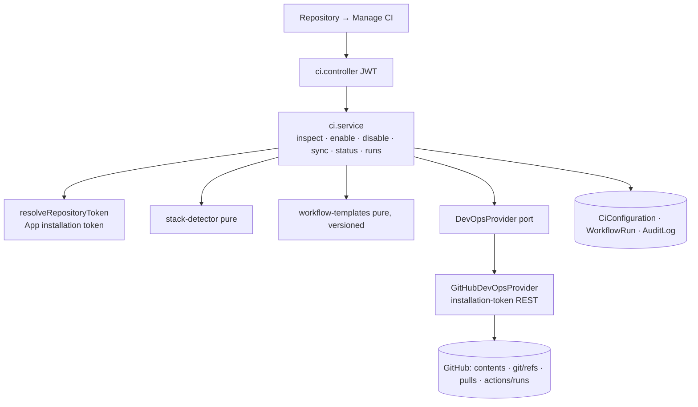

# GitHub Actions Management — Architecture & Operations

> **Status:** implemented on branch `feature/github-actions-management`, building on the GitHub App foundation. This is the **permanent DevOps management layer** — future automation (SonarQube, security scanning, AI review, deployment) extends it via new templates/provider methods without redesign.
> **Auth:** GitHub App installation tokens only. **No PAT is used for repository mutation.**
> **Last updated:** 2026-07-15.

---

## 1. Architecture

**Layering (mirrors the existing provider abstractions):**
- **`DevOpsProvider`** (`modules/devops-providers/`) — a *mutation + Actions* port, deliberately separate from the read-only `GitProvider`: it needs write scopes, App-token auth, and a manager-gated/audit-logged/PR-based risk model. GitHub is the only implementation (`modules/github-devops/`); GitLab/Bitbucket slot in behind it. Registry: `getDevOpsProvider(provider)`.
- **Deterministic core** (`modules/ci/`, pure & unit-tested): `stack-detector.ts` (files → runtime/pm/monorepo/framework/scripts) and `workflow-templates.ts` (detected stack → versioned YAML). No IO, no LLM.
- **`ci.service.ts`** — orchestration, RBAC, audit, persistence. Resolves an installation token per call via the App layer's `resolveRepositoryToken`.

## 2. Repository inspection

`ci.service` fetches the repo's default branch and root files through the provider (`getDefaultBranch`, `getFile`), then `detectStack` reports — deterministically, from real files only:
- runtime (Node only in this MVP; others → `supported: false`, never faked),
- package manager (from `pnpm-lock.yaml` / `yarn.lock` / `package-lock.json`),
- monorepo (`workspaces` in package.json), framework (`next` / `express`),
- Node version (`engines.node` → `.nvmrc` → default 20),
- which **scripts actually exist** (`lint`, `typecheck`/`type-check`, `test`, `build`,
  plus optional `prisma:generate` and `test:coverage` preparation).

**Commands are never invented** — the generator emits a step only when its script is detected.

## 3. Workflow generation (deterministic, versioned)

`generateWorkflow(stack)` renders a reviewed template — **no AI-generated YAML**. It writes to `.github/workflows/devinside-ci.yml` with a version marker (currently `# devinside-managed: node@v3`) so DevInside can recognize and update its own workflow. The `verify` job contains deterministic checkout/runtime/install preparation, optional Prisma generation, and only the present `lint`/`typecheck`/`test`/`build` steps. A provisioned repository also receives a separate push-only SonarQube job with full history, optional coverage generation, and Quality Gate enforcement. Triggers are `push` (default branch), `pull_request`, and `workflow_dispatch`; permissions remain `contents: read`. Unsupported stacks throw `STACK_UNSUPPORTED`.

## 4. Safe installation (PR-based, idempotent)

**DevInside never pushes to the default branch.** `enableCi`:
1. If the managed workflow already exists on the default branch → record `ENABLED`, no PR.
2. Otherwise inspect → generate → create/reuse the `devinside/ci-setup` branch off the default head → commit the workflow → **reuse an open setup PR or open one**.

Idempotency comes from three guards: the on-default-branch check, `createBranch` treating an existing ref as success, and `findOpenPullRequestByHead` reusing an open PR. Clicking **Enable CI** repeatedly never creates duplicate branches or PRs. The customer reviews and merges; on merge, GitHub Actions runs automatically.

## 5. Management & run synchronization

`CiConfiguration` (one per repo) tracks status (`PENDING` → `ENABLED` → `DISABLED`), template id/version, the setup PR + state, and last sync. `syncCi` refreshes the PR state, detects a merged/enabled workflow, and mirrors recent runs into `WorkflowRun` (deduped by `[repositoryId, runId]`): id, workflow, branch, sha, event, status, conclusion, actor, start/end, duration. The dashboard shows status, template version, PR status, latest run + history, last sync, and Workflow/Actions links, with actions **Enable / Disable / Sync / Inspect**. `DevOpsProvider` reserves `dispatchWorkflow` / `cancelWorkflowRun` / `rerunWorkflowRun` as extension points.

## 6. Security

Installation tokens (never persisted, never exposed), App-only auth (no PAT for mutation), private key/secrets never leave the server. Every mutation validates organization membership + **manager role** and repository ownership (`loadRepository` + `requireOrganizationRole`), and writes an `AuditLog` row (`ci.enable` / `ci.disable` / `ci.sync`). The generated workflow itself is least-privilege (`contents: read`); only a provisioned Sonar job can read its project-scoped `SONAR_TOKEN` and public `SONAR_HOST_URL` repository secrets.

### GitHub App permissions required (add before using)

Committing under `.github/workflows/` needs the dedicated **Workflows** permission. Update the DevInside App (Phase-2 settings) and re-accept the installation:

| Permission | Access | For |
|---|---|---|
| Contents | Read & Write | read files for detection; create branch + commit workflow |
| Workflows | Write | write files under `.github/workflows/` |
| Pull requests | Read & Write | open the setup PR |
| Actions | Read | list/sync workflow runs (Read & Write later for dispatch/cancel/rerun) |
| Secrets | Read & Write | inject per-repository Sonar analysis token + public host URL |
| Metadata | Read | mandatory baseline |

A missing permission surfaces as `DEVOPS_PERMISSION_DENIED` with an actionable message.

## 7. Data model & APIs

**Models** (migration `20260715090000_ci_management`, additive, hand-written — apply with `prisma migrate deploy`): `CiConfiguration`, `WorkflowRun`.

**Routes** (`/api/ci`, JWT; mutations manager-gated in the service):

| Method + Path | Purpose |
|---|---|
| `GET /api/ci/status?repositoryId=` | CI status + latest run (member) |
| `GET /api/ci/inspect?repositoryId=` | detected stack (manager) |
| `GET /api/ci/runs?repositoryId=` | run history (member) |
| `POST /api/ci/enable` | inspect → generate → branch → commit → PR (manager) |
| `POST /api/ci/disable` | pause management (manager) |
| `POST /api/ci/sync` | refresh PR + runs (manager) |

## 8. SonarQube-managed workflow

The versioned template used `node@v2` for the first Sonar scan job and now uses
`node@v3` for the hardened contract: the SonarSource action is pinned to the
immutable v8.1.0 commit, full history is checked out, detected Prisma/coverage
steps run before analysis, and the scanner waits up to 300 seconds for the
Quality Gate. A red gate fails only the separate `code_quality` job. The backend
creates a project-scoped token and injects `SONAR_TOKEN` / `SONAR_HOST_URL`; no
client manually enters a token.

## Implemented vs deferred

**Implemented:** DevOpsProvider + GitHub impl, deterministic detection + versioned Node template, idempotent PR-based install, disable/sync/status/inspect, run synchronization + history, models + migration, `/api/ci` routes, repository CI dashboard, automated SonarQube project/token/secret provisioning, push-only Quality Gate-enforced scans, and unit tests (detector, templates, provider idempotency/mapping).

**Deferred:** non-Node templates (Flutter/Python/Java/Go/.NET — architecture ready, reported unsupported until built); workflow dispatch/cancel/rerun UI (provider extension points exist); SonarCloud-specific PR analysis/decoration.
