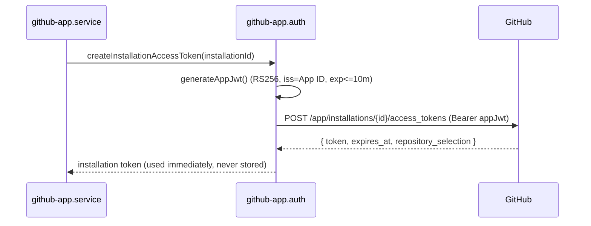
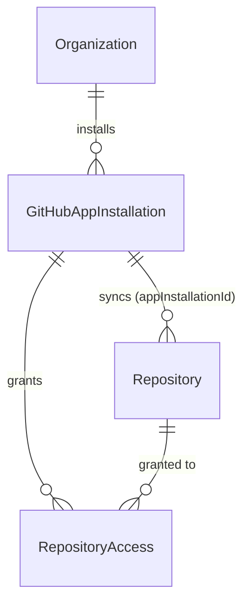

# GitHub App Foundation — Architecture & Setup

> **Status:** Phase 1 (code) implemented on branch `feature/github-app-foundation`. Phase 2 (register the App on GitHub + set env + end-to-end test) is a manual step for the DevInside owner — see [Manual GitHub setup](#manual-github-setup-phase-2).
> **Scope:** securely connect a customer's GitHub repositories to DevInside so engineering activity can be collected — **without** ever asking the customer for a Personal Access Token. This is a *foundation*: future GitHub Actions, SonarQube, and repository automation build on top of it without architectural changes.
> **Last updated:** 2026-07-14.

---

## 1. Architecture

The GitHub App is a **new authentication source** for the *existing* collection stack, not a parallel system. An installation access token is an ordinary Bearer token, so App-synced repositories flow through the same normalized `GitRepository` DTO and the same `Repository` table used by the PAT path — no duplicate rows, no forked pipeline.

```mermaid
flowchart TD
    subgraph Frontend
      UI[Git settings → GitHub App card]
      CB[/dashboard/git/callback]
    end
    subgraph Backend [Express API — modules/github-app]
      AUTH[github-app.auth.ts<br/>App JWT · installation token · webhook verify]
      SVC[github-app.service.ts<br/>link · status · sync · disconnect · webhook events]
      CTRL[github-app.controller.ts JWT]
      WH[github-app.webhook.controller.ts raw body]
    end
    subgraph Data [PostgreSQL / Prisma]
      INST[(GitHubAppInstallation)]
      REPO[(Repository — reused)]
      ACC[(RepositoryAccess)]
      AUD[(AuditLog)]
    end
    GH[(GitHub REST /app, /installation)]

    UI -->|install-url| CTRL
    UI -->|redirect| GH
    GH -->|installation_id| CB
    CB -->|callback + JWT| CTRL
    CTRL --> SVC
    SVC --> AUTH --> GH
    SVC --> INST & REPO & ACC & AUD
    GH -->|installation webhooks HMAC| WH --> SVC
```

**Module boundaries.** `github-app.auth.ts` is the *only* place that touches the App private key / mints tokens. `github-app.service.ts` holds lifecycle + persistence and reuses the shared `common/access` RBAC, `AuditLog`, and the `Repository` upsert convention. Controllers are thin (Zod `.parse()` + delegate). This mirrors the existing `GitProvider` / `LLMProvider` / `ChannelProvider` separation — GitHub-App specifics stay contained, so a future GitLab/Bitbucket equivalent slots in beside it.

**Why the App auth is a dedicated module, not part of `GitProvider`:** `GitProvider` is a *per-token* activity-collection port (`listCommits`, `getCommitDetail`, …). App authentication (JWT signing, installation-token minting, install-URL, webhook verification) is a different concern with a different credential model. Keeping it separate avoids polluting the generic provider interface and lets the two evolve independently.

## 2. Authentication flow

The App authenticates in two hops (standard GitHub App model):

1. **App JWT** — a short-lived (≤10 min) RS256 JWT signed with the App's private key (`iss = App ID`). Authenticates *as the App*. Used only to read installation metadata and mint installation tokens.
2. **Installation access token** — `POST /app/installations/{id}/access_tokens` with the App JWT returns a ~1-hour token scoped to that installation's approved repositories. Used for actual repo reads (e.g. `GET /installation/repositories`).



## 3. Installation flow (user journey)

```mermaid
flowchart LR
    A[Manager: Connect GitHub] --> B[GET /install-url]
    B --> C[Redirect to github.com/apps/&lt;slug&gt;/installations/new]
    C --> D[Choose personal account OR org]
    D --> E[Choose all OR selected repos → Approve]
    E --> F[GitHub redirects to /dashboard/git/callback?installation_id=…]
    F --> G[POST /installations/callback with the user's JWT]
    G --> H[Validate + cross-tenant guard + persist GitHubAppInstallation]
    H --> I[Sync repositories → Repository + RepositoryAccess]
    I --> J[Back to Git settings — connected]
```



The **callback runs on the frontend** because that is where the DevInside org identity lives (the JWT). GitHub's redirect only carries `installation_id`; the backend binds it to the caller's organization.

## 4. Token lifecycle & storage

| Secret | Where it lives | Persisted? |
|---|---|---|
| App private key | `GITHUB_APP_PRIVATE_KEY` env (server only) | env only — never in DB, never sent to the frontend |
| App JWT | generated in memory per call | **No** (≤10 min, discarded) |
| Installation access token | minted on demand, used immediately | **No** (~1 h, never written to DB) |
| Webhook secret | `GITHUB_APP_WEBHOOK_SECRET` env | env only |

The `GitHubAppInstallation` row stores only **non-secret** metadata (account login/type, repository selection, counts, timestamps). This is a deliberate security property: a DB compromise exposes no GitHub credentials.

## 5. Database

Additive migration `…_github_app_foundation` (hand-written — see [migration note](#migration-note)). No existing data is modified.

- **`GitHubAppInstallation`** — one row per GitHub installation linked to a DevInside org. `installationId @unique` (GitHub's numeric id) is the **cross-tenant guard**: an installation can belong to exactly one org. Fields: `organizationId`, `accountLogin`, `accountType`, `targetType`, `repositorySelection`, `permissions (Json)`, `suspendedAt`, `repositoryCount`, `lastSyncedAt`.
- **`RepositoryAccess`** — join `(appInstallationId, repositoryId)` recording which repos an installation currently exposes. Revoking access (webhook `installation_repositories.removed`) deletes the *grant* only; the `Repository` row and its collected history survive.
- **`Repository` (reused)** — `credentialId` is now **nullable** (App repos need no PAT) and a nullable `appInstallationId` FK was added (`ON DELETE SET NULL` — disconnecting keeps the repo). The `@@unique([organizationId, provider, externalId])` key prevents duplicate rows across the PAT and App sources. The 9 collection call-sites that resolve a token from `credentialId` were guarded (a null `credentialId` behaves exactly like the existing "no credential → skip" path).



## 6. APIs

All management routes are JWT-authenticated and take the DevInside org from the session/body; mutations require a manager role (`OWNER|MANAGER|ADMIN`) and write an `AuditLog` row.

| Method + Path | Purpose | Auth |
|---|---|---|
| `GET /api/github-app/status?organizationId=` | Connection status + installations | member |
| `GET /api/github-app/install-url?organizationId=` | The GitHub install URL | manager |
| `POST /api/github-app/installations/callback` | Link an installation (body `{organizationId, installationId, setupAction?}`) | manager |
| `POST /api/github-app/installations/:id/sync` | Resync one installation's repos (body `{organizationId}`) | manager |
| `DELETE /api/github-app/installations/:id?organizationId=` | Disconnect an installation | manager |
| `POST /api/webhooks/github-app` | GitHub App webhook receiver (HMAC, no JWT) | public (signed) |

When the App is unconfigured, management endpoints return `503 GITHUB_APP_NOT_CONFIGURED` and the UI shows a "not available yet" state.

## 7. Webhooks

One App-level webhook URL (`POST /api/webhooks/github-app`) receives events for every installation. It is mounted **before** `express.json()` with a raw-body parser (HMAC needs exact bytes), verifies `X-Hub-Signature-256` against `GITHUB_APP_WEBHOOK_SECRET` (constant-time), answers `202` fast, then processes in the background (never throws):

- **`installation`** — `deleted` → remove the local link (keep history); `suspend`/`unsuspend` → toggle `suspendedAt`; `created`/`new_permissions_accepted` → resync **if already linked** (an installation is bound to an org only via the JWT callback, so unknown installations are ignored).
- **`installation_repositories`** — `added`/`removed` → resync the installation's repositories (reconciles `RepositoryAccess`).

## 8. Security

- **No secret is ever exposed** to the frontend, logged, or persisted (App key + webhook secret in env; tokens in memory only).
- **Webhook signatures** are verified (constant-time HMAC-SHA256) before any processing.
- **Cross-tenant protection:** `installationId @unique` + an explicit check in `linkInstallation` reject linking an installation already owned by another org (`409 INSTALLATION_CLAIMED`); webhook handlers operate strictly on the installation's own org.
- **Installation ownership** is validated on every mutation (`loadOwnedInstallation` scopes by `organizationId`).
- **RBAC / least privilege:** connecting/syncing/disconnecting require a manager role; status is member-visible. The App itself requests read-only repository/metadata permissions (below).
- **Reuses** the existing AES-256-GCM cipher pattern (no new secret storage was needed — the App holds none per-installation), `AuditLog` (every mutation, inside a `$transaction` where applicable), and `organization-access` RBAC helpers.
- **OpenClaw is never given** GitHub App secrets or tokens — it only ever asks the backend, unchanged.

### GitHub App permissions (request the minimum)

| Permission | Access | Why |
|---|---|---|
| Repository → Metadata | Read-only | mandatory baseline; list installation repositories |
| Repository → Contents | Read-only | future commit/activity collection via installation token |
| (Organization) Members | Read-only *(optional)* | future contributor mapping |

Subscribe to webhook events: **Installation** and **Installation repositories**. This foundation needs **no write permissions** — repository mutation (branches/PRs/workflows) is explicitly out of scope and would be a *separate, additively-added* permission later.

## Manual GitHub setup (Phase 2)

Done once by the DevInside owner:

1. GitHub → **Settings → Developer settings → GitHub Apps → New GitHub App**.
2. **Homepage URL**: your app URL. **Callback/Setup URL**: `https://<app>/dashboard/git/callback` and enable *"Redirect on update"*.
3. **Webhook**: Active; URL `https://<api>/api/webhooks/github-app`; set a **Webhook secret**.
4. **Permissions**: as in the table above (read-only). **Subscribe** to *Installation* and *Installation repositories*.
5. **Where can this app be installed**: Any account.
6. Create → note the **App ID**, the **slug** (from the public page URL), the **Client ID**; **Generate a private key** (`.pem`).
7. Set env (`apps/api/.env`): `GITHUB_APP_ID`, `GITHUB_APP_SLUG`, `GITHUB_APP_CLIENT_ID`, `GITHUB_APP_WEBHOOK_SECRET`, and `GITHUB_APP_PRIVATE_KEY` = base64 of the `.pem` (`base64 -i key.pem`).
8. Apply the DB migration: `cd apps/api && npx prisma migrate deploy` (then `npx prisma generate`).
9. Restart the API and click **Connect GitHub** in Git settings to test end-to-end.

### Migration note

The migration SQL is **hand-written** (this repo's established pattern — Neon + a non-interactive shell make `prisma migrate dev` unreliable, and it was **not** applied to any database during Phase 1). `prisma generate` was run so the code compiles against the new models. Apply it in Phase 2 with `prisma migrate deploy`.

## Future integrations (build on this, do NOT require changes)

- **GitHub Actions** (see `docs/architecture/github-actions-ci.md`): a future `DevOpsProvider` uses an installation token (from this module) plus the *Workflows/Contents write* permission to open a PR that installs a CI workflow. The App is the credential source; only new permissions + a new provider are added.
- **SonarQube**: a future `CodeQualityProvider` stores its own credentials (encrypted, reusing `token-cipher`) and reads scan results into the analysis engine. Independent of this module; the App only ever supplies GitHub access.

## Implemented now vs deferred

**Implemented (Phase 1, code):** App JWT + installation-token auth, install-URL, JWT-authenticated callback/link with cross-tenant guard, status, repository sync + `RepositoryAccess` reconciliation, resync, disconnect, HMAC-verified App webhook (installation + installation_repositories), backend APIs, frontend connect/status/sync/disconnect + callback page, `.env.example`, unit tests (JWT, install-token, webhook signature, key normalization, install-URL), this doc.

**Deferred:** applying the migration / registering the App (Phase 2, manual); **collecting activity through installation tokens** (App-synced repos are tracked and ready, but the collection pipeline still resolves a PAT — wiring installation-token resolution into `ensureActivityCollected` is the next step); GitHub App user OAuth (identifying which GitHub user clicked, not needed here); GitLab/Bitbucket App equivalents; and everything under "Do NOT implement" in the task (workflow/branch/PR creation, SonarQube, AI review, deployment).
